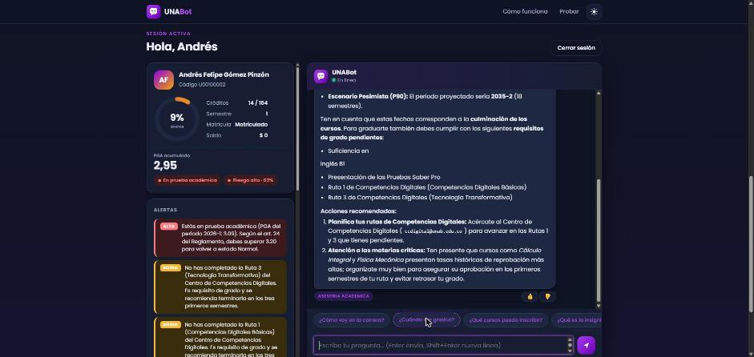
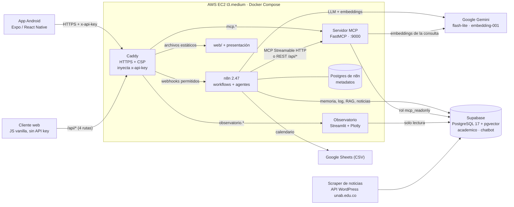
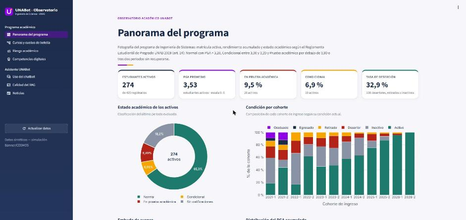
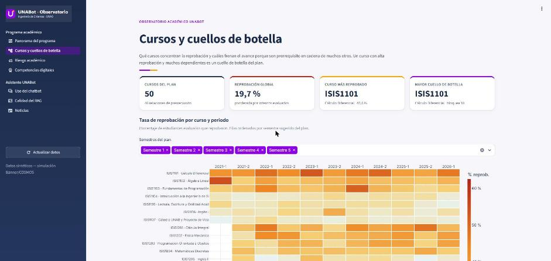

# UNABot · Chatbot de apoyo académico con n8n

**Asistente conversacional para estudiantes de Ingeniería de Sistemas de la UNAB: orquesta agentes en n8n, razona sobre datos académicos con un servidor MCP y responde sobre el reglamento con un RAG evaluado, desde una app Android, un cliente web y un observatorio analítico.**

[](https://github.com/Daniverd15/chatbot-academico-unab/actions/workflows/ci.yml)


Proyecto final de **Ciencia de Datos** · Ingeniería de Sistemas, Universidad Autónoma de Bucaramanga (UNAB).
**Estudiante:** Daniel Enrique Villamizar Ramírez (código U00178823) · **Base:** repositorios del profesor (adiacla) `n8n-workshop`, `mcp` y `Deployment-Mobile-Yolo`.



## Pruébalo

Despliegue en AWS EC2. **Está disponible mientras la sesión del AWS Academy Learner Lab esté activa** (al detenerse el laboratorio, la instancia se apaga; vuelve con la misma IP al presionar *Start Lab*).

| Qué | URL |
|---|---|
| Web + chat | <https://unabot.35-168-41-252.sslip.io> |
| Presentación (18 diapositivas; teclas `f`, `o`, `n`) | <https://unabot.35-168-41-252.sslip.io/presentacion/> |
| Observatorio académico (Streamlit) | <https://observatorio.35-168-41-252.sslip.io> |
| Editor de n8n (requiere login) | <https://n8n.35-168-41-252.sslip.io> |
| Servidor MCP (Bearer) | <https://mcp.35-168-41-252.sslip.io/mcp> |
| Calendario académico (Google Sheets, solo lectura) | <https://docs.google.com/spreadsheets/d/1WzTWekNSU8tRFiVsNMrJyyfQlT8aOOVh6pWgOqSEn5Y/edit> |

### Cuentas de demostración (PIN `1234`)

| Código | Escenario |
|---|---|
| `U00100001` | Estudiante excelente: PGA 4.14, 56.5 % de avance |
| `U00100002` | En prueba académica: PGA 2.95 |
| `U00100003` | Cerca de grado: 92.2 % de avance; le faltan la Ruta 3 de Competencias Digitales y el inglés B1 |
| `U00100004` | Primer ingreso: validó Interacción Digital con la prueba diagnóstica (82) |
| `U00100005` | Matrícula pendiente de pago |

## Qué hace

El estudiante inicia sesión con su código y un PIN (en la app Android o en la web) y obtiene un tablero con su avance, PGA, estado académico, matrícula, alertas, competencias digitales, historial de PGA y proyección de grado. Además conversa en lenguaje natural; un clasificador de intención enruta cada mensaje a uno de **cinco alcances**:

| Alcance | Intención | Cómo se resuelve |
|---|---|---|
| Reglamento y Centro de Competencias Digitales (CCD) | `consulta_general` | RAG híbrido con pgvector, respuesta con fuentes |
| Calendario académico | `calendario` | Google Sheets "UNABot - Calendario académico" leída como CSV (respaldo en `chatbot.calendario`) |
| Noticias de la UNAB | `noticias` | Scraper de la API WordPress de unab.edu.co a `chatbot.noticia` |
| Cursos que ha tomado | `cursos_realizados` | Consulta a vistas SQL del estudiante |
| Asesoría académica personalizada | `asesoria_academica` | Agente con 12 herramientas MCP: planificador, Monte Carlo, riesgo |

Cada respuesta puede calificarse con 👍/👎; la calificación se guarda en `chatbot.conversacion_log.calificacion` y solo el dueño de la conversación puede escribirla.

## Arquitectura



Detalle completo en [docs/arquitectura.md](docs/arquitectura.md).

## Componentes avanzados

| Componente | Qué se hizo | Dónde |
|---|---|---|
| Ingesta y embeddings | Corpus institucional a Markdown, *chunking* (~1000 caracteres, solape 150), `gemini-embedding-001` (3072 dim), índice HNSW sobre `halfvec`; ingesta por script o por workflow n8n | `rag/fetch_corpus.py`, `rag/ingest.py`, `n8n/workflows/` (workflow 00) |
| Recuperación híbrida | Semántica (coseno) + léxica (`tsvector` en español, OR) fusionadas con RRF ponderado | `mcp_server/rag.py`, `database/03_functions_security.sql` |
| Guardrails | Entrada (jailbreak, NSFW, secretos), salida (PII y secretos) y enmascaramiento de códigos de otros estudiantes; todo auditado en `conversacion_log` | `n8n/build_workflows.py`, [docs/arquitectura.md](docs/arquitectura.md) |
| Memoria persistente | Historial por `session_id` en `n8n_chat_histories` (Supabase); sobrevive reinicios | workflows `01_chat`, `07_app` |
| Ruteo por intención | *Text Classifier* barato (flash-lite) a cinco sub-workflows especializados | `n8n/workflows/01_chat.json` |
| Clientes MCP | n8n (MCP Client Tool), cliente de prueba y Claude Desktop (stdio) contra el mismo servidor | `mcp_server/server.py`, `mcp_server/test_client.py` |
| Cliente web | HTML/CSS/JS vanilla sin *build*; la API key no está en el navegador (Caddy la inyecta en el servidor y solo proxea 4 rutas); CSP estricta; renderizador de Markdown construido con DOM y autoprueba de XSS | `web/`, `infra/Caddyfile` |
| Observatorio académico | Streamlit + Plotly, 7 páginas, rol de solo lectura, nombres enmascarados en SQL, sin mostrar preguntas en texto libre | `dashboard/` |
| Presentación | Deck HTML de 18 diapositivas servido desde el mismo sitio | `web/presentacion/` |
| App Android | Rediseño con Poppins, modo oscuro, anillo de progreso animado, gráfico de PGA, lectura en voz alta (TTS) y calificación de respuestas | `mobile/` |

## Ciencia de datos

- **Simulación por agentes:** 420 estudiantes sintéticos (semilla 42) con trayectorias, notas, matrícula y competencias digitales coherentes con las reglas reales del reglamento (`database/generate_synthetic_data.py`).
- **Monte Carlo:** la herramienta de proyección de grado simula los semestres restantes sobre el planificador con prerrequisitos y reporta las simulaciones incompletas (`mcp_server/planner.py`).
- **Modelo de riesgo académico:** regresión logística entrenada con datos sintéticos, **AUC 0.854** y Brier 0.148; aplicada desde el servidor MCP y desde el observatorio con la misma función (`notebooks/01_eda_y_modelo_riesgo.ipynb`, `mcp_server/modelo_riesgo.json`).
- **Evaluación del RAG:** 40 preguntas doradas, tres métodos, barrido del peso léxico (ver resultados abajo y [docs/evaluacion_rag.md](docs/evaluacion_rag.md)).
- **Observatorio académico:** panorama del programa, cuellos de botella con grafo de prerrequisitos, riesgo, competencias digitales, uso del chatbot, calidad del RAG y noticias (ver [dashboard/README.md](dashboard/README.md)).

## Resultados

### Pruebas de extremo a extremo

Medidas contra el sistema desplegado, con la cuenta `U00100002` (`tests/e2e_chat.py`). Las 8 preguntas se enrutaron correctamente (8 de 8).

| Pregunta | Ruta | Latencia |
|---|---|---|
| ¿Cómo voy en la carrera? | `asesoria_academica` | 5.7 s |
| ¿Cuándo me gradúo con 14 créditos? | `asesoria_academica` | 4.9 s |
| ¿Qué es la insignia? | `consulta_general` (RAG) | 7.2 s |
| Inscripciones vacacionales | `calendario` | 9.9 s |
| Cursos de competencias digitales tomados | `cursos_realizados` | 5.7 s |
| Noticias | `noticias` | 4.2 s |
| Intento de jailbreak pidiendo notas de otro estudiante | Bloqueado por guardrail | 2.0 s |
| ¿Recuerdas qué te pregunté? | Memoria persistente | 11.3 s |

Las latencias van de 2 a 11 s.

### Evaluación del RAG

Conjunto dorado de 40 preguntas sobre los 16 documentos del corpus (corrida del 2026-11-17, `rag/eval/resultados.json`).

| Método | hit@1 | hit@3 | hit@5 | MRR@10 |
|---|---:|---:|---:|---:|
| Semántico | 0.950 | 1.000 | 1.000 | 0.975 |
| Léxico (OR, `ts_rank_cd`) | 0.650 | 0.850 | 0.875 | 0.760 |
| Híbrido (RRF, peso léxico 0.0) | 0.950 | 1.000 | 1.000 | 0.975 |

- El léxico mejoró de 0.10 a 0.65 en hit@1 al cambiar la consulta de AND a OR.
- El barrido de RRF ponderado eligió peso léxico **0.0**: ningún peso positivo superó al semántico. El canal léxico se conserva como respaldo si falla el embedding y para términos exactos (códigos de curso, artículos); se ajusta con `RRF_PESO_LEXICO`.
- **Advertencia:** el peso se eligió con las mismas 40 preguntas con que se evalúa, escritas por el propio equipo; las cifras son optimistas y una pregunta mueve hit@1 2.5 puntos.

## Galería

<table>
  <tr>
    <td><br><sub>Landing del cliente web</sub></td>
    <td><br><sub>Chat con respuestas con fuentes</sub></td>
  </tr>
  <tr>
    <td><br><sub>Observatorio: panorama del programa</sub></td>
    <td><br><sub>Observatorio: cursos y cuellos de botella</sub></td>
  </tr>
  <tr>
    <td colspan="2"><br><sub>Presentación: diapositiva de arquitectura</sub></td>
  </tr>
</table>

## Mapa de requisitos del profesor

| Entregable / criterio (peso) | Dónde está implementado | Documento |
|---|---|---|
| Arquitectura del sistema (20 %) | `docker-compose.yml`, `infra/Caddyfile`, `infra/aws_cloudshell_provision.sh`, `mcp_server/`, `n8n/` | [docs/arquitectura.md](docs/arquitectura.md), [docs/despliegue_aws.md](docs/despliegue_aws.md) |
| Implementación de RAG (20 %) | `rag/fetch_corpus.py`, `rag/ingest.py`, `rag/corpus/md/`, `mcp_server/rag.py`, `database/03_functions_security.sql` (`match_documentos`, `buscar_texto`), `rag/evaluate.py`, `rag/eval/` | [docs/rag.md](docs/rag.md), [docs/evaluacion_rag.md](docs/evaluacion_rag.md) |
| Workflows n8n (20 %) | `n8n/build_workflows.py`, `n8n/workflows/*.json`, `n8n/setup_n8n.sh` | [docs/workflows_n8n.md](docs/workflows_n8n.md) |
| Base de datos PostgreSQL (10 %) | `database/01_schema.sql`, `02_views.sql`, `03_functions_security.sql`, `catalogo.py`, `generate_synthetic_data.py`, `load_database.py`, `data/synthetic/` | [docs/base_de_datos.md](docs/base_de_datos.md) |
| Scraper de noticias | `scraper/scraper_noticias.py` (tabla `chatbot.noticia`) | [docs/rag.md](docs/rag.md), [docs/workflows_n8n.md](docs/workflows_n8n.md) |
| Aplicación Android (20 %) | `mobile/` (`App.tsx`, `src/`, `app.json`) | [docs/app_movil.md](docs/app_movil.md) |
| Servidor MCP (herramientas para agentes) | `mcp_server/server.py`, `planner.py`, `rag.py`, `db.py`, `modelo_riesgo.json`, `test_client.py` | [docs/servidor_mcp.md](docs/servidor_mcp.md) |
| Analítica y modelo de riesgo | `notebooks/01_eda_y_modelo_riesgo.ipynb` (generado por `notebooks/build_notebook.py`), `dashboard/` | [docs/servidor_mcp.md](docs/servidor_mcp.md), [dashboard/README.md](dashboard/README.md) |
| Cliente web y presentación | `web/`, `web/presentacion/` | [web/README.md](web/README.md) |
| Documentación técnica (10 %) | Este README y la carpeta `docs/` | — |
| Video demostración | Guion en `docs/guion_video.md` | — |

## Inicio rápido

### Local (desarrollo)

Requisitos: Python 3.12+, Docker (opcional, para una base local), una API key de Google Gemini (AI Studio) y un proyecto de Supabase.

```bash
python -m venv .venv && source .venv/bin/activate      # en Windows: .venv\Scripts\activate
pip install -r mcp_server/requirements.txt faker numpy pandas scikit-learn beautifulsoup4 pypdf psycopg[binary]

cp .env.example .env                  # completar con tus valores (nunca subir .env al repositorio)

python database/generate_synthetic_data.py --estudiantes 420 --seed 42   # genera data/synthetic/*.csv
python database/load_database.py                                          # esquema + vistas + datos + rol de solo lectura
python rag/fetch_corpus.py                                                # corpus institucional -> rag/corpus/md/
python rag/ingest.py                                                      # embeddings -> chatbot.rag_documentos
python scraper/scraper_noticias.py --embed                                # noticias -> chatbot.noticia (+ RAG)

python mcp_server/server.py                                               # http://localhost:9000/mcp (requiere MCP_AUTH_TOKEN y MCP_DATABASE_URL en .env)
python mcp_server/test_client.py http://localhost:9000/mcp U00100001      # prueba de las herramientas
```

Otros componentes en local:

```bash
python rag/evaluate.py                                      # evaluación de la recuperación (ver docs/evaluacion_rag.md)
cd web && python -m http.server 8080                        # cliente web; abrir /?mock=1 para probarlo sin backend
python -m streamlit run dashboard/app.py                    # observatorio en http://localhost:8501
cd mobile && npm install && npx expo start                  # app móvil
```

Para una base de datos local en lugar de Supabase: `docker compose -f docker-compose.yml -f docker-compose.dev.yml up -d db-local` (imagen `pgvector/pgvector:pg16`, puerto `127.0.0.1:55432`; requiere la variable `DB_LOCAL_PASSWORD`).

El APK de Android (arm64-v8a, ~26 MB) se genera localmente con `expo prebuild` y `gradlew assembleRelease` (JDK 21), con la `apiKey` inyectada desde `APP_API_KEY` mediante `mobile/app.config.js`. En Windows, las rutas largas rompen la compilación nativa: se compila desde una copia del proyecto en una ruta corta. Ver [docs/app_movil.md](docs/app_movil.md).

### EC2 (producción del proyecto)

```bash
git clone <url-del-repositorio> chatbot-academico-unab && cd chatbot-academico-unab
cp .env.example .env && nano .env          # N8N_DOMAIN, MCP_DOMAIN, WEB_DOMAIN, DASH_DOMAIN, claves, DATABASE_URL, etc.
docker compose up -d --build               # n8n + postgres de n8n + mcp-server + dashboard + caddy
curl https://mcp.<IP-con-guiones>.sslip.io/health
```

El aprovisionamiento de la instancia (CloudShell), la carga de la base, la ingesta y la importación de workflows están paso a paso en [docs/despliegue_aws.md](docs/despliegue_aws.md).

Despliegue de referencia: instancia `chatbot-unab` en AWS (us-east-1), IP elástica 35.168.41.252. Por ser AWS Academy Learner Lab, la instancia se detiene al terminar la sesión del laboratorio; al presionar *Start Lab* vuelve con la misma IP y los contenedores se reinician solos (`restart: unless-stopped`).

## Estructura del repositorio

```text
chatbot-academico-unab/
├── README.md
├── docker-compose.yml          # n8n, postgres de n8n, mcp-server, dashboard, caddy
├── docker-compose.dev.yml      # base pgvector local para pruebas
├── .env.example                # nombres de variables (sin secretos)
├── .github/workflows/ci.yml    # CI: pytest, workflows regenerados, tsc de la app
├── infra/
│   ├── Caddyfile               # proxy inverso, HTTPS, CSP y rutas de web/n8n/MCP/observatorio
│   └── aws_cloudshell_provision.sh
├── database/
│   ├── 01_schema.sql           # esquemas academico y chatbot
│   ├── 02_views.sql            # vistas analíticas para agentes
│   ├── 03_functions_security.sql  # búsqueda RAG, verificar_pin, rol mcp_readonly
│   ├── catalogo.py             # plan de estudios simulado y oferta CCD
│   ├── generate_synthetic_data.py
│   └── load_database.py
├── data/
│   ├── calendario_academico.csv
│   └── synthetic/              # CSV generados
├── rag/
│   ├── fetch_corpus.py         # descarga y limpia el corpus
│   ├── ingest.py               # chunking + embeddings + inserción
│   ├── evaluate.py             # evaluación de la recuperación
│   ├── eval/                   # conjunto dorado y resultados
│   └── corpus/{md,pdf}/
├── scraper/scraper_noticias.py
├── mcp_server/                 # FastMCP: server, planner, rag, db, modelo de riesgo, Dockerfile
├── n8n/                        # build_workflows.py, workflows/*.json, setup_n8n.sh, ver_errores.sh
├── web/                        # cliente web (index.html, assets/) y presentacion/
├── dashboard/                  # Observatorio académico (Streamlit + Plotly)
├── notebooks/                  # EDA y modelo de riesgo
├── tests/                      # test_planner.py, test_workflows.py (pytest) y e2e_chat.py
├── mobile/                     # app Expo / React Native
└── docs/                       # documentación técnica e imágenes (docs/img)
```

## Calidad y seguridad

- **CI en GitHub Actions** (`.github/workflows/ci.yml`): pytest del planificador y de la integridad de los workflows, compilación de las fuentes Python, verificación de que los workflows regenerados coinciden con los versionados y `tsc --noEmit` de la app. **48 pruebas pasan.**
- **Prueba de extremo a extremo:** `tests/e2e_chat.py` envía una batería de preguntas al chat desplegado.
- **Dos revisiones automáticas de código con Codex.** Correcciones aplicadas:
  - Autenticación del MCP *fail-closed*: no arranca sin `MCP_AUTH_TOKEN` y compara el token en tiempo constante.
  - El PIN es obligatorio para consultar datos de un estudiante por REST.
  - Caddy restringe los webhooks públicos de n8n a los 5 endpoints del proyecto y bloquea los webhooks de prueba y de formularios.
  - Corrección de XSS en el renderizador de Markdown y de una condición de carrera de sesión en el cliente web.
  - Privacidad en el observatorio: nombres enmascarados en SQL y sin preguntas en texto libre.
- **Defensa en profundidad:** rol de base de datos de solo lectura con permisos por columna y `statement_timeout`, consultas parametrizadas, guardrails de entrada y salida, contenedor del MCP sin root, secretos solo en `.env`.
- Las limitaciones conocidas (puertos abiertos por conveniencia del taller, PIN con SHA-256 y no un hash lento, `apiKey` embebida en el APK) están en [docs/arquitectura.md](docs/arquitectura.md#7-seguridad).

## Nota de honestidad sobre los datos

**El plan de estudios (nombres de cursos, créditos, prerrequisitos) y todos los datos de estudiantes son simulados.** No provienen de Banner, COSMOS ni de ningún sistema real de la UNAB. Las fechas del calendario también son simuladas.

Lo que sí es real y se tomó de fuentes públicas:

- Código **SNIES 1643**, duración de **8 semestres más práctica profesional**.
- Las reglas de estado académico del **Reglamento Estudiantil de Pregrado UNAB 2019, art. 24**: Normal (PGA > 3.20), Condicional (3.00–3.20) y En prueba académica.
- Las rutas del **Centro de Competencias Digitales**: Ruta 1 Interacción Digital; Ruta 2 Habilidades de Analítica Digital / Marca Personal Digital / Creación de Contenidos Digitales; Ruta 3 IA Generativa / Marco Legal Digital / Cuidado y Bienestar Digital; umbral de la prueba diagnóstica del 70 %; insignia digital al graduarse.
- Los documentos del corpus RAG (reglamento y publicaciones de unab.edu.co) y las 83 noticias reales del scraper.

El calendario vive en la hoja de Google Sheets "UNABot - Calendario académico" (compartida como "cualquier persona con el enlace puede ver"), que n8n y la herramienta MCP leen como CSV mediante el endpoint de la API de Visualización de Google (`.../gviz/tq?tqx=out:csv&range=A:G`), configurado en `CALENDAR_SHEET_CSV_URL`. Para cambiar fechas basta con editar la hoja: los cambios se recogen en la siguiente pregunta, sin redespliegue. La tabla `chatbot.calendario` queda como respaldo si la hoja no responde. Verificado de extremo a extremo: la pregunta "¿Cuándo empiezan las clases del 2027-1?" se clasificó como `calendario`, la ejecución registró fuente = "Google Sheets" y la respuesta fue 1 de febrero de 2027.

El modelo de riesgo académico se entrenó con datos sintéticos; sus métricas (AUC 0.854, Brier 0.148) describen el comportamiento sobre esa simulación, no sobre estudiantes reales. Del mismo modo, las métricas del RAG provienen de un conjunto pequeño escrito por el propio equipo.

## Documentación

| Documento | Contenido |
|---|---|
| [docs/arquitectura.md](docs/arquitectura.md) | Componentes, diagramas, decisiones de diseño, seguridad |
| [docs/despliegue_aws.md](docs/despliegue_aws.md) | Despliegue paso a paso en EC2 y solución de problemas |
| [docs/rag.md](docs/rag.md) | Corpus, ingesta, índices y recuperación híbrida |
| [docs/evaluacion_rag.md](docs/evaluacion_rag.md) | Metodología, iteraciones y resultados de la evaluación del RAG |
| [docs/workflows_n8n.md](docs/workflows_n8n.md) | Workflows, modelos y credenciales de n8n |
| [docs/base_de_datos.md](docs/base_de_datos.md) | Esquemas, vistas, funciones y datos sintéticos |
| [docs/servidor_mcp.md](docs/servidor_mcp.md) | Herramientas MCP, planificador y modelo de riesgo |
| [docs/app_movil.md](docs/app_movil.md) | App Android: ejecución y APK |
| [web/README.md](web/README.md) | Cliente web |
| [dashboard/README.md](dashboard/README.md) | Observatorio académico |
| [docs/guion_video.md](docs/guion_video.md) | Guion del video de demostración |

## Créditos

- Daniel Enrique Villamizar Ramírez, Ingeniería de Sistemas, UNAB — materia Ciencia de Datos.
- Basado en los repositorios del profesor (github.com/adiacla): `n8n-workshop`, `mcp` y `Deployment-Mobile-Yolo`.
- Tecnologías: n8n, FastMCP, PostgreSQL/Supabase con pgvector, Google Gemini, Caddy, Docker, Expo/React Native, Streamlit, Plotly.
