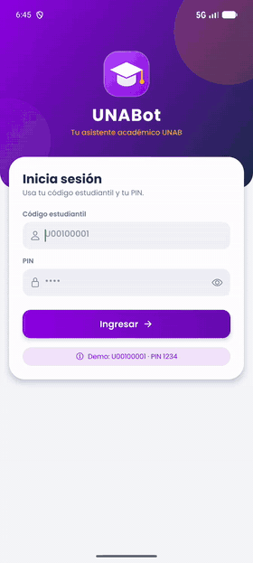
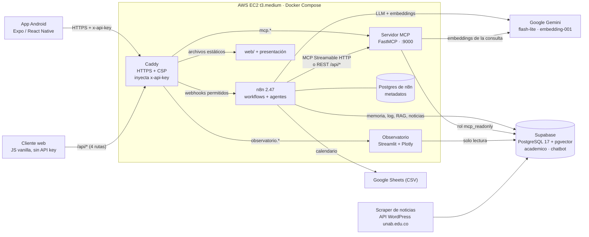
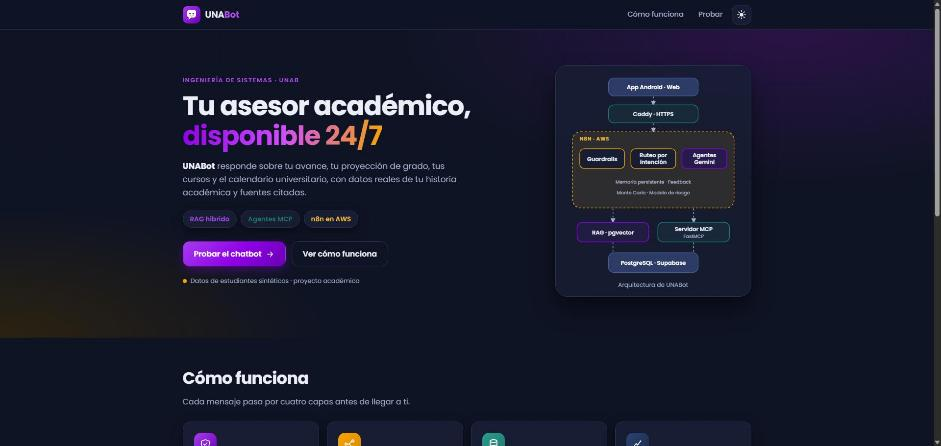
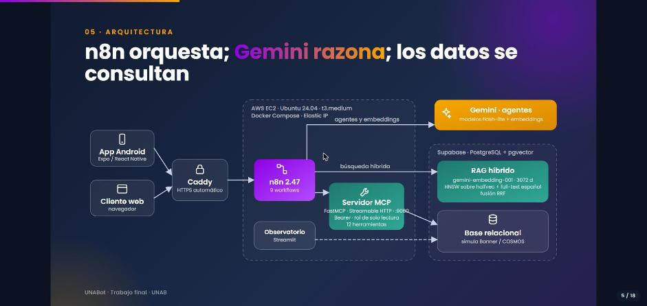

# UNABot · Chatbot de apoyo académico con n8n

**Asistente conversacional para estudiantes de Ingeniería de Sistemas de la UNAB: orquesta agentes en n8n, razona sobre datos académicos con un servidor MCP y responde sobre el reglamento con un RAG evaluado, desde una app Android, un cliente web y un observatorio analítico.**

[](https://github.com/Daniverd15/chatbot-academico-unab/actions/workflows/ci.yml)


Proyecto final de **Ciencia de Datos** · Ingeniería de Sistemas, Universidad Autónoma de Bucaramanga (UNAB).
**Estudiante:** Daniel Enrique Villamizar Ramírez (código U00178823) · **Base:** repositorios del profesor (adiacla) `n8n-workshop`, `mcp` y `Deployment-Mobile-Yolo`.


## Pruébalo

Despliegue en AWS EC2. **Está disponible mientras la sesión del AWS Academy Learner Lab esté activa** (al detenerse el laboratorio, la instancia se apaga; vuelve con la misma IP al presionar *Start Lab*).

| Qué | URL |
|---|---|
| Web + chat | <https://unabot.35-168-41-252.sslip.io> |
| Presentación (18 diapositivas; teclas `f`, `o`, `n`) | <https://unabot.35-168-41-252.sslip.io/presentacion/> |
| Observatorio académico (Streamlit) | <https://observatorio.35-168-41-252.sslip.io> |
| Editor de n8n (requiere login) | <https://n8n.35-168-41-252.sslip.io> |
| Servidor MCP (Bearer) | <https://mcp.35-168-41-252.sslip.io/mcp> |
| Calendario académico (Google Sheets, solo lectura) | <https://docs.google.com/spreadsheets/d/1WzTWekNSU8tRFiVsNMrJyyfQlT8aOOVh6pWgOqSEn5Y/edit> |

### Video de demostración



**[▶ Ver el video (4:22, 1080p)](https://github.com/Daniverd15/chatbot-academico-unab/releases/download/v1.0.0/unabot_demo.mp4)** · **[⬇ Descargar el APK](https://github.com/Daniverd15/chatbot-academico-unab/releases/download/v1.0.0/chatbot-unab.apk)**

Grabado en un emulador Android (Pixel, Android 17) contra el despliegue real en AWS, sin datos preparados: inicio de sesión y tablero con riesgo explicable, asesoría con el agente MCP, RAG institucional, calendario desde Google Sheets, historial de competencias digitales, noticias, bloqueo por guardrails, memoria persistente, plan de estudios y novedades. Las esperas del modelo se recortan y en pantalla se indica el tiempo real de cada respuesta.

El video se genera con scripts: `adb screenrecord` graba cada escena y [`scripts/video/montar_video.py`](scripts/video/montar_video.py) compone el teléfono con un panel explicativo, tarjetas de título y el diagrama de arquitectura (ver [docs/guion_video.md](docs/guion_video.md)).

<br clear="right">

### Cuentas de demostración (PIN `1234`)

| Código | Escenario |
|---|---|
| `U00100001` | Estudiante excelente: PGA 4.14, 56.5 % de avance |
| `U00100002` | En prueba académica: PGA 2.95 |
| `U00100003` | Cerca de grado: 92.2 % de avance; le faltan la Ruta 3 de Competencias Digitales y el inglés B1 |
| `U00100004` | Primer ingreso: validó Interacción Digital con la prueba diagnóstica (82) |
| `U00100005` | Matrícula pendiente de pago |

## Qué hace

El estudiante inicia sesión con su código y un PIN (en la app Android o en la web) y obtiene un tablero con su avance, PGA, estado académico, matrícula, alertas, competencias digitales, historial de PGA y proyección de grado. Además conversa en lenguaje natural; un clasificador de intención enruta cada mensaje a uno de **cinco alcances**:

| Alcance | Intención | Cómo se resuelve |
|---|---|---|
| Reglamento y Centro de Competencias Digitales (CCD) | `consulta_general` | RAG híbrido con pgvector, respuesta con fuentes |
| Calendario académico | `calendario` | Google Sheets "UNABot - Calendario académico" leída como CSV (respaldo en `chatbot.calendario`) |
| Noticias de la UNAB | `noticias` | Scraper de la API WordPress de unab.edu.co a `chatbot.noticia` |
| Cursos que ha tomado | `cursos_realizados` | Consulta a vistas SQL del estudiante |
| Asesoría académica personalizada | `asesoria_academica` | Agente con 12 herramientas MCP: planificador, Monte Carlo, riesgo |

Cada respuesta puede calificarse con 👍/👎; la calificación se guarda en `chatbot.conversacion_log.calificacion` y solo el dueño de la conversación puede escribirla.

## Arquitectura



Detalle completo en [docs/arquitectura.md](docs/arquitectura.md).

## Componentes avanzados

| Componente | Qué se hizo | Dónde |
|---|---|---|
| Ingesta y embeddings | Corpus institucional a Markdown, *chunking* (~1000 caracteres, solape 150), `gemini-embedding-001` (3072 dim), índice HNSW sobre `halfvec`; ingesta por script o por workflow n8n | `rag/fetch_corpus.py`, `rag/ingest.py`, `n8n/workflows/` (workflow 00) |
| Recuperación híbrida | Semántica (coseno) + léxica (`tsvector` en español, OR) fusionadas con RRF ponderado | `mcp_server/rag.py`, `database/03_functions_security.sql` |
| Guardrails | Entrada (jailbreak, NSFW, secretos), salida (PII y secretos) y enmascaramiento de códigos de otros estudiantes; todo auditado en `conversacion_log` | `n8n/build_workflows.py`, [docs/arquitectura.md](docs/arquitectura.md) |
| Memoria persistente | Historial por `session_id` en `n8n_chat_histories` (Supabase); sobrevive reinicios | workflows `01_chat`, `07_app` |
| Ruteo por intención | *Text Classifier* barato (flash-lite) a cinco sub-workflows especializados | `n8n/workflows/01_chat.json` |
| Clientes MCP | n8n (MCP Client Tool), Claude Code remoto por HTTP Streamable (probado), OpenAI Responses API (configuración documentada), Claude Desktop (stdio) y cliente de prueba contra el mismo servidor | `mcp_server/server.py`, `mcp_server/test_client.py` |
| Cliente web | HTML/CSS/JS vanilla sin *build*; la API key no está en el navegador (Caddy la inyecta en el servidor y solo proxea 4 rutas); CSP estricta; renderizador de Markdown construido con DOM y autoprueba de XSS | `web/`, `infra/Caddyfile` |
| Observatorio académico | Streamlit + Plotly, 7 páginas, rol de solo lectura, nombres enmascarados en SQL, sin mostrar preguntas en texto libre | `dashboard/` |
| Presentación | Deck HTML de 18 diapositivas servido desde el mismo sitio | `web/presentacion/` |
| Riesgo explicable (XAI) | Cada predicción del modelo de riesgo trae sus factores (contribución coef·z en log-odds) y una frase en lenguaje natural; la app muestra la tarjeta «¿Por qué?» con barras divergentes y el observatorio la importancia global y un *waterfall* por estudiante | `mcp_server/server.py`, `mobile/src/components/RiskFactors.tsx`, `dashboard/vistas/riesgo.py` |
| Alertas tempranas proactivas | Workflow 08 diario: detecta estudiantes en prueba académica, condicionales o con alertas altas y Gemini redacta un mensaje de acompañamiento con acciones concretas, que consejería revisa en el observatorio antes de enviarlo | `n8n/workflows/08_alertas.json`, `database/04_alertas_tempranas.sql`, `dashboard/vistas/alertas.py` |
| Evaluación de la generación | Además de la recuperación, un juez LLM puntúa fidelidad, relevancia, precisión del contexto y corrección de las respuestas del RAG | `rag/evaluate_generacion.py`, [docs/evaluacion_rag.md](docs/evaluacion_rag.md) |
| App Android | Rediseño con Poppins, modo oscuro, anillo de progreso animado, gráfico de PGA, lectura en voz alta (TTS) y calificación de respuestas | `mobile/` |

## Ciencia de datos

- **Simulación por agentes:** 420 estudiantes sintéticos (semilla 42) con trayectorias, notas, matrícula y competencias digitales coherentes con las reglas reales del reglamento (`database/generate_synthetic_data.py`).
- **Monte Carlo:** la herramienta de proyección de grado simula los semestres restantes sobre el planificador con prerrequisitos y reporta las simulaciones incompletas (`mcp_server/planner.py`).
- **Modelo de riesgo académico:** regresión logística entrenada con datos sintéticos, **AUC 0.854** y Brier 0.148; aplicada desde el servidor MCP y desde el observatorio con la misma función (`notebooks/01_eda_y_modelo_riesgo.ipynb`, `mcp_server/modelo_riesgo.json`).
- **Evaluación del RAG:** 40 preguntas doradas, tres métodos, barrido del peso léxico (ver resultados abajo y [docs/evaluacion_rag.md](docs/evaluacion_rag.md)).
- **Observatorio académico:** panorama del programa, cuellos de botella con grafo de prerrequisitos, riesgo, competencias digitales, uso del chatbot, calidad del RAG y noticias (ver [dashboard/README.md](dashboard/README.md)).

## Resultados

### Pruebas de extremo a extremo

Medidas contra el sistema desplegado, con la cuenta `U00100002` (`tests/e2e_chat.py`). Las 8 preguntas se enrutaron correctamente (8 de 8).

| Pregunta | Ruta | Latencia |
|---|---|---|
| ¿Cómo voy en la carrera? | `asesoria_academica` | 5.7 s |
| ¿Cuándo me gradúo con 14 créditos? | `asesoria_academica` | 4.9 s |
| ¿Qué es la insignia? | `consulta_general` (RAG) | 7.2 s |
| Inscripciones vacacionales | `calendario` | 9.9 s |
| Cursos de competencias digitales tomados | `cursos_realizados` | 5.7 s |
| Noticias | `noticias` | 4.2 s |
| Intento de jailbreak pidiendo notas de otro estudiante | Bloqueado por guardrail | 2.0 s |
| ¿Recuerdas qué te pregunté? | Memoria persistente | 11.3 s |

Las latencias van de 2 a 11 s.

### Evaluación del RAG

Conjunto dorado de 40 preguntas sobre los 16 documentos del corpus (corrida del 2026-11-17, `rag/eval/resultados.json`).

| Método | hit@1 | hit@3 | hit@5 | MRR@10 |
|---|---:|---:|---:|---:|
| Semántico | 0.950 | 1.000 | 1.000 | 0.975 |
| Léxico (OR, `ts_rank_cd`) | 0.650 | 0.850 | 0.875 | 0.760 |
| Híbrido (RRF, peso léxico 0.0) | 0.950 | 1.000 | 1.000 | 0.975 |

- El léxico mejoró de 0.10 a 0.65 en hit@1 al cambiar la consulta de AND a OR.
- El barrido de RRF ponderado eligió peso léxico **0.0**: ningún peso positivo superó al semántico. El canal léxico se conserva como respaldo si falla el embedding y para términos exactos (códigos de curso, artículos); se ajusta con `RRF_PESO_LEXICO`.
- **Generación (LLM-as-judge, 40 preguntas, `rag/eval/resultados_generacion.json`):** fidelidad **0.985**, relevancia 1.000, precisión del contexto 0.355, corrección 1.000. La fidelidad casi perfecta indica que las respuestas no inventan datos fuera de los fragmentos; la precisión del contexto baja muestra que de los 5 fragmentos recuperados suelen servir 1 o 2 (margen para un *reranker*). El juez es del mismo proveedor que el generador y tiende a ser indulgente: relevancia y corrección saturadas no equivalen a exactitud perfecta.
- **Advertencia:** el peso se eligió con las mismas 40 preguntas con que se evalúa, escritas por el propio equipo; las cifras son optimistas y una pregunta mueve hit@1 2.5 puntos.

## Galería

<table>
  <tr>
    <td><br><sub>Landing del cliente web</sub></td>
    <td><br><sub>Chat con respuestas con fuentes</sub></td>
  </tr>
  <tr>
    <td><br><sub>Observatorio: panorama del programa</sub></td>
    <td><br><sub>Observatorio: cursos y cuellos de botella</sub></td>
  </tr>
  <tr>
    <td colspan="2"><br><sub>Presentación: diapositiva de arquitectura</sub></td>
  </tr>
</table>

## Cumplimiento del enunciado, diapositiva por diapositiva

Verificado contra el despliegue en AWS el 17-nov-2026.

| Diapositiva | Requisito | Cómo se cumple | Evidencia |
|---|---|---|---|
| Objetivo | Matrícula y avance del plan | Herramientas MCP `consultar_estado_matricula` y `avance_plan_estudios`, vista `v_avance_plan`, tablero de la app | «¿Cómo voy en la carrera?» → asesor MCP |
| Objetivo | Proyección de semestres restantes y alertas de requisitos | `proyeccion_graduacion` (Monte Carlo P50/P90) y `alertas_requisitos` (`v_alertas`) | «¿Cuándo me gradúo si inscribo 14 créditos?» |
| Objetivo | Recomendaciones personalizadas | `recomendaciones_personalizadas` y modelo de riesgo (AUC 0.854) | «¿Qué cursos debo tomar el próximo semestre?» |
| Objetivo | Base conceptual: RAG, n8n, PostgreSQL y app móvil | Los cuatro implementados y desplegados | Secciones Arquitectura y Galería |
| Infraestructura | AWS EC2 Ubuntu con Security Groups y puerto 9000 | t3.medium Ubuntu; SG con 22, 80, 443, 5678 y 9000 | `curl http://35.168.41.252:9000/health` → `ok` |
| Infraestructura | n8n containerizado | `docker-compose.yml` con n8n, Postgres de n8n, MCP, observatorio y Caddy | `docker ps` en la EC2 |
| Infraestructura | Supabase PostgreSQL + pgvector simulando Banner/COSMOS | Esquema `academico` (registro tipo Banner: matrícula, notas, plan; tipo COSMOS: `cd_curso`, `cd_inscripcion`, prueba diagnóstica) y `chatbot` (RAG, calendario, noticias, logs); 10 vistas analíticas; índice HNSW | [docs/base_de_datos.md](docs/base_de_datos.md) |
| Infraestructura | Servidor MCP (FastMCP) en AWS | 12 herramientas sobre Supabase, HTTP Streamable con token | https://mcp.35-168-41-252.sslip.io/health |
| Alcance funcional | Ruta y cursos / insignia | Asesor MCP + RAG del CCD | «¿Qué es la insignia de competencias digitales?» |
| Alcance funcional | RAG institucional con embeddings en pgvector | 245 fragmentos, `gemini-embedding-001`; hit@1 0.95 | [docs/evaluacion_rag.md](docs/evaluacion_rag.md) |
| Alcance funcional | Calendario desde Google Sheets | Workflow 03 lee la hoja en vivo; si falla, usa la tabla de respaldo en BD | Respuesta con `fuente = Google Sheets` |
| Alcance funcional | Historial personalizado (cursos CCD tomados) | Workflow 04 sobre `academico.cd_inscripcion` y `v_competencias_digitales` | «¿Qué cursos de competencias digitales he tomado?» |
| Alcance funcional | Noticias por web scraping periódico | Workflow 05b cada 12 h + `scraper/scraper_noticias.py` | Ejecución programada con estado `success` |
| Componentes avanzados | Ingesta y embeddings en n8n | Workflow 00: Webhook → Text Splitter → Embeddings Gemini → PGVector | `n8n/workflows/00_ingesta.json` |
| Componentes avanzados | Guardrails | Guardrails de entrada (jailbreak, NSFW, PII, claves secretas) y de salida (sanitize) + enmascarado de códigos ajenos | Intento de inyección → `bloqueado=True` |
| Componentes avanzados | Memoria persistente entre sesiones | Postgres Chat Memory con clave = código del estudiante | «¿Qué fue lo primero que te pregunté hoy?» recuerda chats anteriores |
| Componentes avanzados | Ruteo por intención | Text Classifier con 5 intenciones → sub-workflows | Campo `intencion` en cada respuesta |
| Componentes avanzados | Clientes MCP (Claude / OpenAI) | n8n MCP Client, Claude Code remoto (probado), OpenAI Responses API (documentado) | [docs/servidor_mcp.md](docs/servidor_mcp.md#7-cómo-conectarse) |
| Workflows | 01 Consulta general: pregunta → LLM → RAG → respuesta | Archivo `02_general.json` | — |
| Workflows | 02 Calendario: pregunta → intención → Google Sheets → respuesta | Archivo `03_calendario.json` (la intención la detecta `01_chat`) | — |
| Workflows | 03 Cursos realizados: pregunta → BD estudiantes → respuesta personalizada | Archivo `04_cursos.json` | — |
| Workflows | 04 Noticias: scraping → actualización BD → respuesta | Archivos `05b_scraper.json` (scraping) y `05_noticias.json` (respuesta) | — |

Los archivos van corridos un número respecto a la diapositiva porque `01_chat.json` es el router que hace la detección de intención y llama a los cuatro workflows del enunciado. `00` (ingesta), `06` (asesor MCP), `07` (API de la app) y `08` (alertas tempranas) son adicionales.

## Mapa de requisitos del profesor

| Entregable / criterio (peso) | Dónde está implementado | Documento |
|---|---|---|
| Arquitectura del sistema (20 %) | `docker-compose.yml`, `infra/Caddyfile`, `infra/aws_cloudshell_provision.sh`, `mcp_server/`, `n8n/` | [docs/arquitectura.md](docs/arquitectura.md), [docs/despliegue_aws.md](docs/despliegue_aws.md) |
| Implementación de RAG (20 %) | `rag/fetch_corpus.py`, `rag/ingest.py`, `rag/corpus/md/`, `mcp_server/rag.py`, `database/03_functions_security.sql` (`match_documentos`, `buscar_texto`), `rag/evaluate.py`, `rag/eval/` | [docs/rag.md](docs/rag.md), [docs/evaluacion_rag.md](docs/evaluacion_rag.md) |
| Workflows n8n (20 %) | `n8n/build_workflows.py`, `n8n/workflows/*.json`, `n8n/setup_n8n.sh` | [docs/workflows_n8n.md](docs/workflows_n8n.md) |
| Base de datos PostgreSQL (10 %) | `database/01_schema.sql`, `02_views.sql`, `03_functions_security.sql`, `catalogo.py`, `generate_synthetic_data.py`, `load_database.py`, `data/synthetic/` | [docs/base_de_datos.md](docs/base_de_datos.md) |
| Scraper de noticias | `scraper/scraper_noticias.py` (tabla `chatbot.noticia`) | [docs/rag.md](docs/rag.md), [docs/workflows_n8n.md](docs/workflows_n8n.md) |
| Aplicación Android (20 %) | `mobile/` (`App.tsx`, `src/`, `app.json`) | [docs/app_movil.md](docs/app_movil.md) |
| Servidor MCP (herramientas para agentes) | `mcp_server/server.py`, `planner.py`, `rag.py`, `db.py`, `modelo_riesgo.json`, `test_client.py` | [docs/servidor_mcp.md](docs/servidor_mcp.md) |
| Analítica y modelo de riesgo | `notebooks/01_eda_y_modelo_riesgo.ipynb` (generado por `notebooks/build_notebook.py`), `dashboard/` | [docs/servidor_mcp.md](docs/servidor_mcp.md), [dashboard/README.md](dashboard/README.md) |
| Cliente web y presentación | `web/`, `web/presentacion/` | [web/README.md](web/README.md) |
| Documentación técnica (10 %) | Este README y la carpeta `docs/` | — |
| Video demostración | [unabot_demo.mp4](https://github.com/Daniverd15/chatbot-academico-unab/releases/download/v1.0.0/unabot_demo.mp4) (4:22, grabado en el emulador contra AWS); `scripts/video/montar_video.py` | [docs/guion_video.md](docs/guion_video.md) |

## Replicar el proyecto desde cero

Esta guía lleva de un computador vacío al sistema completo en la nube (unas 2 horas, todo con capas gratuitas). Cada paso termina con una comprobación; si algo falla, mira la tabla de [problemas frecuentes](#problemas-frecuentes-y-solución).

### Paso 0. Cuentas y herramientas

| Necesitas | Para qué | Costo |
|---|---|---|
| Cuenta de Google con [AI Studio](https://aistudio.google.com/apikey) | API key de Gemini (LLM y embeddings) | Gratis (capa free) |
| Proyecto en [Supabase](https://supabase.com) | PostgreSQL 17 + pgvector | Gratis |
| Cuenta de AWS (o AWS Academy Learner Lab) | EC2 t3.medium con Docker | Créditos del lab |
| Google Sheets (cualquier cuenta de Google) | Calendario académico | Gratis |
| Python 3.12+, Git, Node.js 20+ | Scripts, app móvil | — |
| Opcional: Android Studio + JDK 21 | Compilar el APK | — |

> Si tu cuenta de Google es institucional y no te deja crear proyectos en AI Studio, usa una cuenta personal. Los modelos usados (`gemini-3.5-flash-lite`, `gemini-3.1-flash-lite`, `gemini-embedding-001`) están disponibles en la capa gratuita; los modelos *flash* completos son más lentos y agotan la cuota rápido.

### Paso 1. Clonar e instalar

```bash
git clone https://github.com/Daniverd15/chatbot-academico-unab.git
cd chatbot-academico-unab
python -m venv .venv
source .venv/bin/activate          # Windows: .venv\Scripts\activate
pip install -r requirements.txt
cp .env.example .env               # Windows: copy .env.example .env
```

Comprueba: `python -m pytest tests -q` debe pasar todo (no necesita red ni base de datos).

### Paso 2. Completar `.env`

Genera los secretos aleatorios así y pégalos en `.env` (nunca subas `.env` al repositorio, ya está en `.gitignore`):

```bash
python -c "import secrets; [print(k, secrets.token_urlsafe(32)) for k in ['MCP_AUTH_TOKEN','APP_API_KEY','N8N_DB_PASSWORD','MCP_DB_PASSWORD']]; print('N8N_ENCRYPTION_KEY', secrets.token_hex(16))"
```

| Variable | De dónde sale |
|---|---|
| `GEMINI_API_KEY` | AI Studio → *Create API key* |
| `DATABASE_URL` | Supabase → *Connect* → **Session pooler** (IPv4, puerto 5432). Usuario `postgres.<project_ref>` |
| `MCP_DATABASE_URL` | Igual que la anterior pero con usuario `mcp_readonly.<project_ref>` y la contraseña `MCP_DB_PASSWORD` (el rol lo crea el paso 3) |
| `N8N_DOMAIN`, `MCP_DOMAIN`, `WEB_DOMAIN`, `DASH_DOMAIN` | Se completan en el paso 6 con la IP de la EC2 (`n8n.1-2-3-4.sslip.io`, etc.) |
| `CALENDAR_SHEET_CSV_URL` | Paso 5 |

### Paso 3. Base de datos (Supabase)

```bash
python database/generate_synthetic_data.py --estudiantes 420 --seed 42   # data/synthetic/*.csv (reproducible)
python database/load_database.py                                          # esquemas, 10 vistas, funciones, rol de solo lectura y datos
```

> `load_database.py` **borra y recrea** los esquemas `academico` y `chatbot`. Ejecútalo solo para instalar o reinstalar.

Comprueba en Supabase → *SQL Editor*: `select codigo, pga_acumulado, estado_academico from academico.v_estudiante_resumen where codigo = 'U00100002';` devuelve un estudiante en prueba académica.

### Paso 4. RAG institucional y noticias

```bash
python rag/fetch_corpus.py                 # descarga páginas y PDF de la UNAB y el CCD -> rag/corpus/md/
python rag/ingest.py                       # chunking + embeddings (3072 d) -> chatbot.rag_documentos
python scraper/scraper_noticias.py --embed # noticias reales de unab.edu.co -> chatbot.noticia
python rag/evaluate.py                     # opcional: hit@k y MRR sobre 40 preguntas doradas
```

Comprueba: `select count(*) from chatbot.rag_documentos;` devuelve unos 245 fragmentos más las noticias.

### Paso 5. Calendario en Google Sheets

1. Crea una hoja nueva y usa *Archivo → Importar → Subir* con `data/calendario_academico.csv` (reemplazar hoja actual).
2. *Compartir → Acceso general → Cualquier persona con el enlace → Lector*.
3. Copia el ID de la URL (`/spreadsheets/d/<ID>/edit`) y escribe en `.env`:
   `CALENDAR_SHEET_CSV_URL=https://docs.google.com/spreadsheets/d/<ID>/gviz/tq?tqx=out:csv&range=A:G`

Comprueba: abrir esa URL en el navegador descarga un CSV. Si la hoja falla, el workflow usa la tabla `chatbot.calendario` como respaldo.

### Paso 6. Infraestructura en AWS

En la consola de AWS abre **CloudShell** (región `us-east-1`), sube `infra/aws_cloudshell_provision.sh` y ejecuta:

```bash
export PUBKEY="ssh-rsa AAAA... tu-llave-publica"   # opcional; sin esto se crea ~/chatbot-unab-key.pem
bash aws_cloudshell_provision.sh
```

Crea el Security Group (22, 80, 443, 5678, **9000**), una EC2 Ubuntu 24.04 t3.medium con 30 GB, swap de 4 GB, Docker, e IP elástica. Imprime la IP pública: con ella completa los dominios en `.env` (IP `1.2.3.4` → `n8n.1-2-3-4.sslip.io`, `mcp.1-2-3-4.sslip.io`, `unabot.1-2-3-4.sslip.io`, `observatorio.1-2-3-4.sslip.io`). [sslip.io](https://sslip.io) resuelve esos nombres a la IP sin comprar dominio y Caddy obtiene los certificados HTTPS solo.

### Paso 7. Levantar los servicios

```bash
ssh -i chatbot-unab-key.pem ubuntu@<IP>
git clone https://github.com/Daniverd15/chatbot-academico-unab.git chatbot && cd chatbot
nano .env                      # pega tu .env completo
docker compose up -d --build   # n8n, Postgres de n8n, servidor MCP, observatorio y Caddy
```

Comprueba: `curl https://mcp.<IP-con-guiones>.sslip.io/health` → `{"status":"ok","db":true}` y `curl http://<IP>:9000/health` (puerto 9000 abierto, como pide el enunciado).

### Paso 8. n8n: cuenta, credenciales y workflows

1. Abre `https://n8n.<IP-con-guiones>.sslip.io` y crea la cuenta *owner* (la primera vez).
2. En la EC2: `bash n8n/setup_n8n.sh`. Crea las 3 credenciales (Gemini, Supabase, Bearer del MCP) con IDs fijos, importa los workflows de `n8n/workflows/`, **publica primero los sub-workflows y al final el chat** y reinicia n8n.
3. Si cambias algún workflow, edítalo en `n8n/build_workflows.py`, regenera los JSON con `python n8n/build_workflows.py` y repite el paso 2.

Comprueba desde tu PC: `python tests/e2e_chat.py` ejecuta login, tablero y 8 preguntas (una por intención, guardrails y memoria) contra n8n y muestra intención, latencia y respuesta.

### Paso 9. App móvil

**Probar sin compilar (Android o iPhone):** instala *Expo Go* en el teléfono y, en el PC (misma red Wi-Fi):

```bash
cd mobile && npm install
API_URL=https://n8n.<IP-con-guiones>.sslip.io/webhook APP_API_KEY=<tu APP_API_KEY> npx expo start   # agrega --tunnel si están en redes distintas
```

En PowerShell define antes las variables: `$env:API_URL="..."; $env:APP_API_KEY="..."`. Escanea el QR con la cámara (iPhone) o con Expo Go (Android).

**Compilar el APK** (JDK 21 y Android SDK):

```bash
cd mobile
API_URL=... APP_API_KEY=... npx expo prebuild --platform android --clean
cd android && ./gradlew assembleRelease -PreactNativeArchitectures=arm64-v8a,x86_64
# APK: android/app/build/outputs/apk/release/app-release.apk  (~45 MB, teléfonos y emulador)
```

> En Windows, la compilación nativa falla con rutas largas (`ninja: error: mkdir ... No such file or directory`). Copia `mobile/` a una ruta corta (p. ej. `C:\ubm`) y compila desde allí. Detalle en [docs/app_movil.md](docs/app_movil.md).

### Paso 10. Componentes opcionales en local

```bash
python -m streamlit run dashboard/app.py         # observatorio en http://localhost:8501
cd web && python -m http.server 8080             # cliente web; /?mock=1 funciona sin backend
python mcp_server/server.py                      # servidor MCP local en http://localhost:9000/mcp
python mcp_server/test_client.py http://localhost:9000/mcp U00100001
python notebooks/build_notebook.py               # regenera el notebook de EDA y modelo de riesgo
```

Base de datos local en lugar de Supabase: `docker compose -f docker-compose.yml -f docker-compose.dev.yml up -d db-local` (pgvector/pg16 en `127.0.0.1:55432`, requiere `DB_LOCAL_PASSWORD`).

### Problemas frecuentes y solución

| Síntoma | Causa | Solución |
|---|---|---|
| La app o la web se quedan "pensando" | La EC2 está apagada (el Learner Lab la detiene al terminar la sesión) | *Start Lab*, esperar ~2 min a que los contenedores arranquen; la IP elástica no cambia |
| La primera respuesta tarda 30–60 s | Arranque en frío de n8n y Gemini | Hacer una pregunta de calentamiento antes de la demo |
| n8n: `Webhook not registered` en `/webhook/chat` | El chat se publicó antes que sus sub-workflows | Volver a ejecutar `bash n8n/setup_n8n.sh` (publica en el orden correcto) |
| Gemini `400 Unknown name "type"` en herramientas MCP | Parámetros opcionales con `None` | Ya resuelto: los parámetros opcionales usan `""` por defecto |
| Gemini `429 RESOURCE_EXHAUSTED` | Cuota de la capa gratuita | Usar los modelos *flash-lite* del `.env.example`; esperar un minuto |
| `permission denied for schema extensions` | El rol de solo lectura no ve pgvector | `load_database.py` ya concede `USAGE` en `extensions`; volver a ejecutarlo |
| El calendario responde con la tabla de respaldo | La hoja no es pública o la URL usa `/export` (redirige) | Compartir "cualquiera con el enlace" y usar la URL `gviz/tq?tqx=out:csv` |
| Gemini `400 ... function call turn comes immediately after a user turn` | La memoria de ventana cortaba el historial en medio de una llamada a herramienta | `database/05_memoria_chat.sql`: un *trigger* guarda en la memoria solo los turnos de texto humano/asistente |
| `mcp` 2.x: `cannot import FastMCP` | Cambio de API en el SDK | Se fija `mcp[cli]>=1.12,<2` en `mcp_server/requirements.txt` |
| La app se cierra al abrir en el emulador | APK solo con arquitectura arm64 | Compilar con `-PreactNativeArchitectures=arm64-v8a,x86_64` |
| El emulador no tiene internet | DNS del emulador | Iniciarlo con `-dns-server 8.8.8.8,1.1.1.1` |

Guía de despliegue más detallada (seguridad, Caddy, actualización): [docs/despliegue_aws.md](docs/despliegue_aws.md).

## Estructura del repositorio

```text
chatbot-academico-unab/
├── README.md
├── docker-compose.yml          # n8n, postgres de n8n, mcp-server, dashboard, caddy
├── docker-compose.dev.yml      # base pgvector local para pruebas
├── .env.example                # nombres de variables (sin secretos)
├── .github/workflows/ci.yml    # CI: pytest, workflows regenerados, tsc de la app
├── infra/
│   ├── Caddyfile               # proxy inverso, HTTPS, CSP y rutas de web/n8n/MCP/observatorio
│   └── aws_cloudshell_provision.sh
├── database/
│   ├── 01_schema.sql           # esquemas academico y chatbot
│   ├── 02_views.sql            # vistas analíticas para agentes
│   ├── 03_functions_security.sql  # búsqueda RAG, verificar_pin, rol mcp_readonly
│   ├── catalogo.py             # plan de estudios simulado y oferta CCD
│   ├── 04_alertas_tempranas.sql   # tabla de alertas del workflow 08
│   ├── 05_memoria_chat.sql     # trigger: memoria solo con turnos de texto
│   ├── generate_synthetic_data.py
│   └── load_database.py
├── data/
│   ├── calendario_academico.csv
│   └── synthetic/              # CSV generados
├── rag/
│   ├── fetch_corpus.py         # descarga y limpia el corpus
│   ├── ingest.py               # chunking + embeddings + inserción
│   ├── evaluate.py             # evaluación de la recuperación
│   ├── evaluate_generacion.py  # evaluación de la generación (LLM-as-judge)
│   ├── eval/                   # conjunto dorado y resultados
│   └── corpus/{md,pdf}/
├── scraper/scraper_noticias.py
├── scripts/video/montar_video.py  # monta el video de demostración
├── mcp_server/                 # FastMCP: server, planner, rag, db, modelo de riesgo, Dockerfile
├── n8n/                        # build_workflows.py, workflows/*.json, setup_n8n.sh, ver_errores.sh
├── web/                        # cliente web (index.html, assets/) y presentacion/
├── dashboard/                  # Observatorio académico (Streamlit + Plotly)
├── notebooks/                  # EDA y modelo de riesgo
├── tests/                      # test_planner.py, test_workflows.py (pytest) y e2e_chat.py
├── mobile/                     # app Expo / React Native
└── docs/                       # documentación técnica e imágenes (docs/img)
```

## Calidad y seguridad

- **CI en GitHub Actions** (`.github/workflows/ci.yml`): pytest del planificador, de la explicabilidad del riesgo y de la integridad de los workflows, compilación de las fuentes Python, verificación de que los workflows regenerados coinciden con los versionados y `tsc --noEmit` de la app. **64 pruebas pasan.**
- **Prueba de extremo a extremo:** `tests/e2e_chat.py` envía una batería de preguntas al chat desplegado.
- **Dos revisiones automáticas de código con Codex.** Correcciones aplicadas:
  - Autenticación del MCP *fail-closed*: no arranca sin `MCP_AUTH_TOKEN` y compara el token en tiempo constante.
  - El PIN es obligatorio para consultar datos de un estudiante por REST.
  - Caddy restringe los webhooks públicos de n8n a los 5 endpoints del proyecto y bloquea los webhooks de prueba y de formularios.
  - Corrección de XSS en el renderizador de Markdown y de una condición de carrera de sesión en el cliente web.
  - Privacidad en el observatorio: nombres enmascarados en SQL y sin preguntas en texto libre.
- **Defensa en profundidad:** rol de base de datos de solo lectura con permisos por columna y `statement_timeout`, consultas parametrizadas, guardrails de entrada y salida, contenedor del MCP sin root, secretos solo en `.env`.
- Las limitaciones conocidas (puertos abiertos por conveniencia del taller, PIN con SHA-256 y no un hash lento, `apiKey` embebida en el APK) están en [docs/arquitectura.md](docs/arquitectura.md#7-seguridad).

## Nota de honestidad sobre los datos

**El plan de estudios (nombres de cursos, créditos, prerrequisitos) y todos los datos de estudiantes son simulados.** No provienen de Banner, COSMOS ni de ningún sistema real de la UNAB. Las fechas del calendario también son simuladas.

Lo que sí es real y se tomó de fuentes públicas:

- Código **SNIES 1643**, duración de **8 semestres más práctica profesional**.
- Las reglas de estado académico del **Reglamento Estudiantil de Pregrado UNAB 2019, art. 24**: Normal (PGA > 3.20), Condicional (3.00–3.20) y En prueba académica.
- Las rutas del **Centro de Competencias Digitales**: Ruta 1 Interacción Digital; Ruta 2 Habilidades de Analítica Digital / Marca Personal Digital / Creación de Contenidos Digitales; Ruta 3 IA Generativa / Marco Legal Digital / Cuidado y Bienestar Digital; umbral de la prueba diagnóstica del 70 %; insignia digital al graduarse.
- Los documentos del corpus RAG (reglamento y publicaciones de unab.edu.co) y las 83 noticias reales del scraper.

El calendario vive en la hoja de Google Sheets "UNABot - Calendario académico" (compartida como "cualquier persona con el enlace puede ver"), que n8n y la herramienta MCP leen como CSV mediante el endpoint de la API de Visualización de Google (`.../gviz/tq?tqx=out:csv&range=A:G`), configurado en `CALENDAR_SHEET_CSV_URL`. Para cambiar fechas basta con editar la hoja: los cambios se recogen en la siguiente pregunta, sin redespliegue. La tabla `chatbot.calendario` queda como respaldo si la hoja no responde. Verificado de extremo a extremo: la pregunta "¿Cuándo empiezan las clases del 2027-1?" se clasificó como `calendario`, la ejecución registró fuente = "Google Sheets" y la respuesta fue 1 de febrero de 2027.

El modelo de riesgo académico se entrenó con datos sintéticos; sus métricas (AUC 0.854, Brier 0.148) describen el comportamiento sobre esa simulación, no sobre estudiantes reales. Del mismo modo, las métricas del RAG provienen de un conjunto pequeño escrito por el propio equipo.

## Documentación

| Documento | Contenido |
|---|---|
| [docs/arquitectura.md](docs/arquitectura.md) | Componentes, diagramas, decisiones de diseño, seguridad |
| [docs/despliegue_aws.md](docs/despliegue_aws.md) | Despliegue paso a paso en EC2 y solución de problemas |
| [docs/rag.md](docs/rag.md) | Corpus, ingesta, índices y recuperación híbrida |
| [docs/evaluacion_rag.md](docs/evaluacion_rag.md) | Metodología, iteraciones y resultados de la evaluación del RAG |
| [docs/workflows_n8n.md](docs/workflows_n8n.md) | Workflows, modelos y credenciales de n8n |
| [docs/base_de_datos.md](docs/base_de_datos.md) | Esquemas, vistas, funciones y datos sintéticos |
| [docs/servidor_mcp.md](docs/servidor_mcp.md) | Herramientas MCP, planificador y modelo de riesgo |
| [docs/app_movil.md](docs/app_movil.md) | App Android: ejecución y APK |
| [web/README.md](web/README.md) | Cliente web |
| [dashboard/README.md](dashboard/README.md) | Observatorio académico |
| [docs/guion_video.md](docs/guion_video.md) | Guion del video de demostración |
| [docs/guia_sustentacion.md](docs/guia_sustentacion.md) | Guía para la sustentación: guion de 15 min, demo, cifras clave, banco de preguntas y plan de contingencia |

## Créditos

- Daniel Enrique Villamizar Ramírez, Ingeniería de Sistemas, UNAB — materia Ciencia de Datos.
- Basado en los repositorios del profesor (github.com/adiacla): `n8n-workshop`, `mcp` y `Deployment-Mobile-Yolo`.
- Tecnologías: n8n, FastMCP, PostgreSQL/Supabase con pgvector, Google Gemini, Caddy, Docker, Expo/React Native, Streamlit, Plotly.
