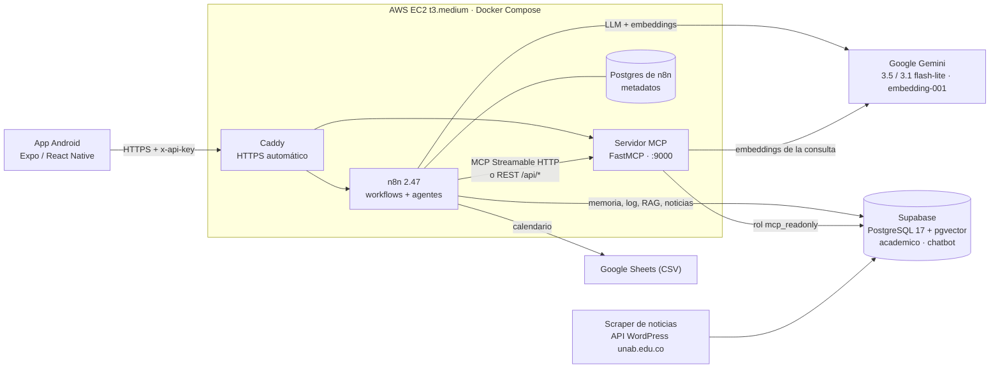

# Chatbot de apoyo académico con n8n — Ingeniería de Sistemas UNAB

Proyecto final de la materia **Ciencia de Datos** · Ingeniería de Sistemas, Universidad Autónoma de Bucaramanga (UNAB).

- **Estudiante:** Daniel Enrique Villamizar Ramírez (código U00178823)
- **Repositorios base del profesor (adiacla):** `n8n-workshop` (n8n en EC2), `mcp` (FastMCP), `Deployment-Mobile-Yolo` (app Expo)

## Qué hace

Un asistente conversacional que acompaña a un estudiante de Ingeniería de Sistemas durante su carrera. Desde una app Android el estudiante inicia sesión con su código y un PIN y puede:

- Ver un tablero con su avance, PGA, estado académico, matrícula, alertas, competencias digitales y proyección de grado.
- Preguntar en lenguaje natural por el reglamento, el Centro de Competencias Digitales (CCD), el calendario, las noticias de la UNAB, los cursos que ha tomado y su asesoría académica personalizada.

La orquestación está en **n8n** (workflows con guardrails, clasificación de intención, memoria y agentes). Los datos académicos viven en **PostgreSQL (Supabase)**, la recuperación de documentos usa **RAG híbrido con pgvector**, y las herramientas relacionales y analíticas se exponen a los agentes mediante un **servidor MCP (FastMCP)**.

## Arquitectura



Detalle completo en [docs/arquitectura.md](docs/arquitectura.md).

## Mapa de requisitos del profesor

| Entregable / criterio (peso) | Dónde está implementado | Documento |
|---|---|---|
| Arquitectura del sistema (20 %) | `docker-compose.yml`, `infra/Caddyfile`, `infra/aws_cloudshell_provision.sh`, `mcp_server/`, `n8n/` | [docs/arquitectura.md](docs/arquitectura.md), [docs/despliegue_aws.md](docs/despliegue_aws.md) |
| Implementación de RAG (20 %) | `rag/fetch_corpus.py`, `rag/ingest.py`, `rag/corpus/md/`, `mcp_server/rag.py`, `database/03_functions_security.sql` (`match_documentos`, `buscar_texto`) | [docs/rag.md](docs/rag.md) |
| Workflows n8n (20 %) | `n8n/build_workflows.py`, `n8n/workflows/*.json`, `n8n/setup_n8n.sh` | [docs/workflows_n8n.md](docs/workflows_n8n.md) |
| Base de datos PostgreSQL (10 %) | `database/01_schema.sql`, `02_views.sql`, `03_functions_security.sql`, `catalogo.py`, `generate_synthetic_data.py`, `load_database.py`, `data/synthetic/` | [docs/base_de_datos.md](docs/base_de_datos.md) |
| Scraper de noticias | `scraper/scraper_noticias.py` (tabla `chatbot.noticia`) | [docs/rag.md](docs/rag.md), [docs/workflows_n8n.md](docs/workflows_n8n.md) |
| Aplicación Android (20 %) | `mobile/` (`App.tsx`, `src/`, `app.json`) | [docs/app_movil.md](docs/app_movil.md) |
| Servidor MCP (herramientas para agentes) | `mcp_server/server.py`, `planner.py`, `rag.py`, `db.py`, `modelo_riesgo.json`, `test_client.py` | [docs/servidor_mcp.md](docs/servidor_mcp.md) |
| Analítica y modelo de riesgo | `notebooks/01_eda_y_modelo_riesgo.ipynb` (generado por `notebooks/build_notebook.py`) | [docs/servidor_mcp.md](docs/servidor_mcp.md) |
| Documentación técnica (10 %) | Este README y la carpeta `docs/` | — |
| Video demostración | Guion en `docs/guion_video.md` | — |

## Inicio rápido

### Local (desarrollo)

Requisitos: Python 3.12+, Docker (opcional, para una base local), una API key de Google Gemini (AI Studio) y un proyecto de Supabase.

```bash
python -m venv .venv && source .venv/bin/activate      # en Windows: .venv\Scripts\activate
pip install -r mcp_server/requirements.txt faker numpy pandas scikit-learn beautifulsoup4 pypdf psycopg[binary]

cp .env.example .env                  # completar con tus valores (nunca subir .env al repositorio)

python database/generate_synthetic_data.py --estudiantes 420 --seed 42   # genera data/synthetic/*.csv
python database/load_database.py                                          # esquema + vistas + datos + rol de solo lectura
python rag/fetch_corpus.py                                                # corpus institucional -> rag/corpus/md/
python rag/ingest.py                                                      # embeddings -> chatbot.rag_documentos
python scraper/scraper_noticias.py --embed                                # noticias -> chatbot.noticia (+ RAG)

python mcp_server/server.py                                               # http://localhost:9000/mcp (requiere MCP_AUTH_TOKEN y MCP_DATABASE_URL en .env)
python mcp_server/test_client.py http://localhost:9000/mcp U00100001      # prueba de las herramientas
```

Para una base de datos local en lugar de Supabase: `docker compose -f docker-compose.yml -f docker-compose.dev.yml up -d db-local` (imagen `pgvector/pgvector:pg16`, puerto `127.0.0.1:55432`; requiere la variable `DB_LOCAL_PASSWORD`).

La app móvil se ejecuta con `cd mobile && npm install && npx expo start` (ver [docs/app_movil.md](docs/app_movil.md)). El APK de Android se genera localmente con `expo prebuild` y `gradlew assembleRelease` (JDK 21), con la `apiKey` inyectada desde `APP_API_KEY` mediante `mobile/app.config.js`.

### EC2 (producción del proyecto)

```bash
git clone <url-del-repositorio> chatbot-academico-unab && cd chatbot-academico-unab
cp .env.example .env && nano .env          # N8N_DOMAIN, MCP_DOMAIN, claves, DATABASE_URL, etc.
docker compose up -d --build               # n8n + postgres de n8n + mcp-server + caddy
curl https://mcp.<IP-con-guiones>.sslip.io/health
```

El aprovisionamiento de la instancia (CloudShell), la carga de la base, la ingesta y la importación de workflows están paso a paso en [docs/despliegue_aws.md](docs/despliegue_aws.md).

Despliegue de referencia: instancia `chatbot-unab` en AWS (us-east-1), `https://n8n.35-168-41-252.sslip.io` y `https://mcp.35-168-41-252.sslip.io`. Por ser AWS Academy Learner Lab, la instancia se detiene al terminar la sesión del laboratorio; al presionar *Start Lab* vuelve con la misma IP elástica y los contenedores se reinician solos (`restart: unless-stopped`).

## Cuentas de demostración (PIN `1234`)

| Código | Escenario |
|---|---|
| `U00100001` | Estudiante excelente: PGA 4.14, 56.5 % de avance |
| `U00100002` | En prueba académica: PGA 2.95 |
| `U00100003` | Cerca de grado: 92.2 % de avance; le faltan la Ruta 3 de Competencias Digitales y el inglés B1 |
| `U00100004` | Primer ingreso: validó Interacción Digital con la prueba diagnóstica (82) |
| `U00100005` | Matrícula pendiente de pago |

## Pruebas de extremo a extremo

Medidas contra el sistema desplegado, con la cuenta `U00100002`. Las 8 preguntas se enrutaron correctamente (8 de 8).

| Pregunta | Ruta | Latencia |
|---|---|---|
| ¿Cómo voy en la carrera? | `asesoria_academica` | 5.7 s |
| ¿Cuándo me gradúo con 14 créditos? | `asesoria_academica` | 4.9 s |
| ¿Qué es la insignia? | `consulta_general` (RAG) | 7.2 s |
| Inscripciones vacacionales | `calendario` | 9.9 s |
| Cursos de competencias digitales tomados | `cursos_realizados` | 5.7 s |
| Noticias | `noticias` | 4.2 s |
| Intento de jailbreak pidiendo notas de otro estudiante | Bloqueado por guardrail | 2.0 s |
| ¿Recuerdas qué te pregunté? | Memoria persistente | 11.3 s |

Las latencias van de 2 a 11 s.

## Estructura del repositorio

```text
chatbot-academico-unab/
├── README.md
├── docker-compose.yml          # n8n, postgres de n8n, mcp-server, caddy
├── docker-compose.dev.yml      # base pgvector local para pruebas
├── .env.example                # nombres de variables (sin secretos)
├── infra/
│   ├── Caddyfile               # proxy inverso + HTTPS automático
│   └── aws_cloudshell_provision.sh
├── database/
│   ├── 01_schema.sql           # esquemas academico y chatbot
│   ├── 02_views.sql            # vistas analíticas para agentes
│   ├── 03_functions_security.sql  # búsqueda RAG, verificar_pin, rol mcp_readonly
│   ├── catalogo.py             # plan de estudios simulado y oferta CCD
│   ├── generate_synthetic_data.py
│   └── load_database.py
├── data/
│   ├── calendario_academico.csv
│   └── synthetic/              # CSV generados
├── rag/
│   ├── fetch_corpus.py         # descarga y limpia el corpus
│   ├── ingest.py               # chunking + embeddings + inserción
│   └── corpus/{md,pdf}/
├── scraper/scraper_noticias.py
├── mcp_server/                 # FastMCP: server, planner, rag, db, modelo de riesgo, Dockerfile
├── n8n/                        # build_workflows.py, workflows/*.json, setup_n8n.sh, ver_errores.sh
├── notebooks/                  # EDA y modelo de riesgo
├── tests/                      # test_planner.py (pytest) y e2e_chat.py
├── mobile/                     # app Expo / React Native
└── docs/                       # documentación técnica
```

## Nota de honestidad sobre los datos

**El plan de estudios (nombres de cursos, créditos, prerrequisitos) y todos los datos de estudiantes son simulados.** No provienen de Banner, COSMOS ni de ningún sistema real de la UNAB. Las fechas del calendario también son simuladas.

Lo que sí es real y se tomó de fuentes públicas:

- Código **SNIES 1643**, duración de **8 semestres más práctica profesional**.
- Las reglas de estado académico del **Reglamento Estudiantil de Pregrado UNAB 2019, art. 24**: Normal (PGA > 3.20), Condicional (3.00–3.20) y En prueba académica.
- Las rutas del **Centro de Competencias Digitales**: Ruta 1 Interacción Digital; Ruta 2 Habilidades de Analítica Digital / Marca Personal Digital / Creación de Contenidos Digitales; Ruta 3 IA Generativa / Marco Legal Digital / Cuidado y Bienestar Digital; umbral de la prueba diagnóstica del 70 %; insignia digital al graduarse.
- Los documentos del corpus RAG (reglamento y publicaciones de unab.edu.co) y las 83 noticias reales del scraper.

El calendario se lee de una hoja de Google Sheets publicada como CSV, cuya URL va en `CALENDAR_SHEET_CSV_URL`. **Estado actual:** la hoja aún no está publicada, la variable está vacía y el sistema usa la tabla de respaldo `chatbot.calendario`.

El modelo de riesgo académico se entrenó con datos sintéticos; sus métricas (AUC 0.854, Brier 0.148) describen el comportamiento sobre esa simulación, no sobre estudiantes reales.

## Créditos

- Daniel Enrique Villamizar Ramírez, Ingeniería de Sistemas, UNAB — materia Ciencia de Datos.
- Basado en los repositorios del profesor (github.com/adiacla): `n8n-workshop`, `mcp` y `Deployment-Mobile-Yolo`.
- Tecnologías: n8n, FastMCP, PostgreSQL/Supabase con pgvector, Google Gemini, Caddy, Docker, Expo/React Native.
