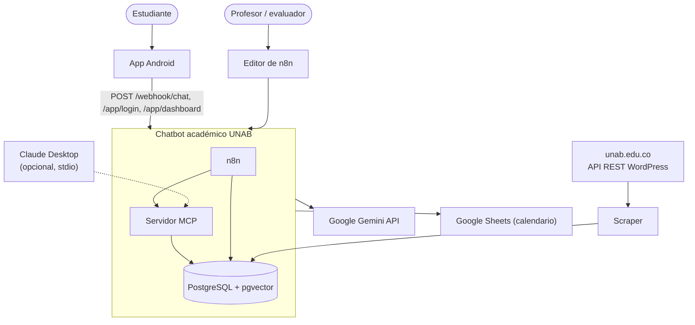
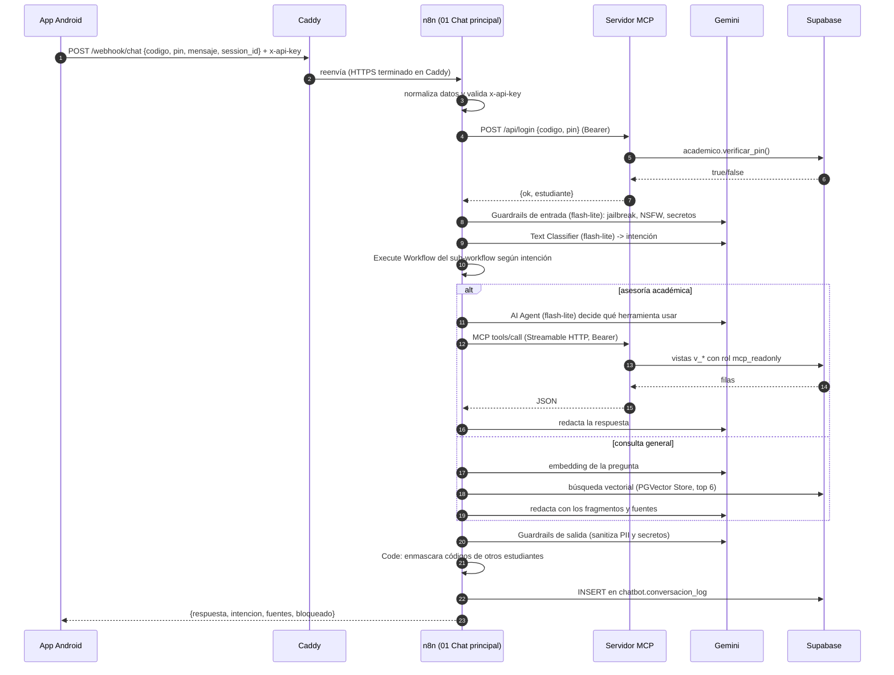
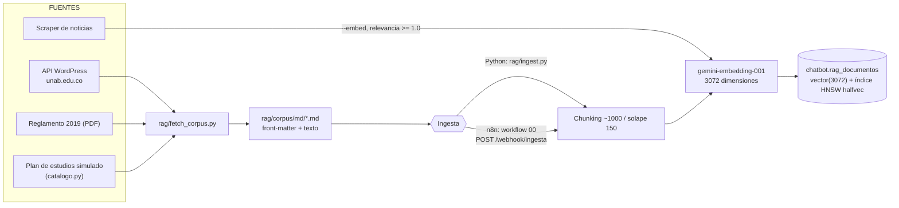

# Arquitectura del sistema

## 1. Visión general

El sistema tiene cuatro capas:

1. **Cliente:** app Android (Expo / React Native) que habla únicamente con webhooks de n8n.
2. **Orquestación y razonamiento:** n8n con workflows que validan, clasifican la intención, ejecutan agentes de Gemini y aplican guardrails.
3. **Herramientas y datos:** servidor MCP (FastMCP) con herramientas relacionales/analíticas, y PostgreSQL en Supabase con pgvector para los datos académicos simulados y el RAG.
4. **Infraestructura:** una instancia AWS EC2 con Docker Compose y Caddy para HTTPS automático.

## 2. Componentes

| Componente | Tecnología | Responsabilidad | Ubicación |
|---|---|---|---|
| App móvil | Expo SDK 58, React Native 0.88 | Login, tablero, chat, plan, novedades | `mobile/` |
| n8n | n8n 2.47 (Docker) | Webhooks, router de intenciones, agentes, guardrails, memoria, scraper programado | contenedor `n8n` |
| Postgres de n8n | PostgreSQL 16 (Docker) | Metadatos de n8n: workflows, credenciales cifradas, ejecuciones | contenedor `postgres-n8n` |
| Servidor MCP | Python 3.12, FastMCP, Starlette/uvicorn, psycopg | 12 herramientas, recurso y prompt MCP, puente REST, `/health` | `mcp_server/`, contenedor `mcp-server`, puerto 9000 |
| Caddy | Caddy 2 | TLS automático (Let's Encrypt) y proxy inverso hacia n8n y MCP | `infra/Caddyfile` |
| Base de datos | Supabase: PostgreSQL 17 + pgvector, región East US (Ohio), Session pooler (IPv4) | Esquemas `academico` y `chatbot`, vistas, funciones de búsqueda, rol de solo lectura | `database/` |
| LLM | Google Gemini (capa gratuita) | Agente asesor MCP: `gemini-3.5-flash-lite`; agente RAG: `gemini-3.1-flash-lite`; clasificador y redacción: `gemini-3.5-flash-lite`; guardrails: `gemini-3.1-flash-lite`; embeddings: `gemini-embedding-001` | variables `GEMINI_*` |
| Scraper | Python + API REST de WordPress | Noticias de unab.edu.co a `chatbot.noticia` | `scraper/` |
| Calendario | Google Sheets "UNABot - Calendario académico" leído como CSV (respaldo en `chatbot.calendario`) | Fechas académicas simuladas. Hoja en vivo vía `CALENDAR_SHEET_CSV_URL`; `chatbot.calendario` solo se usa si la hoja no responde | `data/calendario_academico.csv` |

## 2.1 Cliente web, Observatorio y enrutamiento de Caddy

| Componente | Tecnología | Responsabilidad | Ubicación |
|---|---|---|---|
| Cliente web | HTML/CSS/JS vanilla, sin build | Landing, login y chat con calificación 👍/👎; presentación de 18 diapositivas en `/presentacion/` | `web/`, servido por Caddy desde `/srv/web` |
| Observatorio académico | Streamlit + Plotly (contenedor `dashboard`, puerto 8501) | 7 páginas analíticas de solo lectura (panorama, cursos y cuellos de botella, riesgo, competencias digitales, uso del chatbot, calidad del RAG, noticias) | `dashboard/` |

**Cliente web.** La página no contiene ninguna API key: llama a rutas relativas `/api/*` y Caddy las reescribe a `/webhook/*` de n8n añadiendo la cabecera `x-api-key` en el servidor. Solo se proxean cuatro rutas (`/api/chat`, `/api/app/login`, `/api/app/dashboard`, `/api/app/feedback`); cualquier otra responde 404. Se sirve con una CSP estricta (`default-src 'self'`, `frame-ancestors 'none'`), el Markdown de las respuestas se construye con nodos DOM (sin `innerHTML`) y el cliente incluye una autoprueba de XSS.

**Observatorio.** Se conecta con un rol de solo lectura (`DASH_DATABASE_URL`, con respaldo en `MCP_DATABASE_URL`). Los nombres de estudiantes se enmascaran en SQL, los códigos de la bitácora se muestran parcialmente ocultos y no se muestran preguntas en texto libre. El modelo de riesgo y los resultados de la evaluación del RAG se montan como volúmenes de solo lectura. Detalle en [../dashboard/README.md](../dashboard/README.md).

**Calificaciones.** El 👍/👎 se guarda en `chatbot.conversacion_log.calificacion` a través del webhook `/webhook/app/feedback`, que verifica que la conversación pertenezca al estudiante autenticado.

### Rutas de Caddy (`infra/Caddyfile`)

| Dominio (variable) | Ruta | Destino |
|---|---|---|
| `N8N_DOMAIN` | `/webhook/chat`, `/webhook/app/login`, `/webhook/app/dashboard`, `/webhook/app/feedback`, `/webhook/ingesta` | `n8n:5678` (cada webhook valida además `x-api-key` o el PIN) |
| `N8N_DOMAIN` | `/webhook/*` restantes, `/webhook-test/*`, `/webhook-waiting/*`, `/form*`, `/mcp*` | 404 |
| `N8N_DOMAIN` | resto (editor) | `n8n:5678`, protegido por el login de n8n |
| `MCP_DOMAIN` | todo | `mcp-server:9000` (Bearer en `/mcp` y `/api/*`; `/health` público) |
| `WEB_DOMAIN` | `/api/chat`, `/api/app/login`, `/api/app/dashboard`, `/api/app/feedback` | `n8n:5678/webhook/...` con `x-api-key` inyectada; otras rutas `/api/*`: 404 |
| `WEB_DOMAIN` | resto | archivos estáticos de `web/` con CSP (incluye `/presentacion/`) |
| `DASH_DOMAIN` | todo | `dashboard:8501` |

Todos los dominios añaden HSTS, `X-Content-Type-Options` y `Referrer-Policy`.

### Infraestructura AWS

- Cuenta AWS Academy Learner Lab, región us-east-1.
- Instancia `chatbot-unab`: Ubuntu 24.04, t3.medium, disco gp3 de 30 GB, IP elástica 35.168.41.252, 4 GB de swap.
- Security Group `chatbot-unab-sg`: puertos 22, 80, 443, 5678 y 9000.
- Dominios `sslip.io` derivados de la IP: `https://n8n.35-168-41-252.sslip.io`, `https://mcp.35-168-41-252.sslip.io`, `https://unabot.35-168-41-252.sslip.io` (web y presentación) y `https://observatorio.35-168-41-252.sslip.io`.

## 3. Diagrama de contexto

## 4. Secuencia de un mensaje de chat

Si un guardrail bloquea el mensaje, el flujo salta la clasificación y los agentes y responde con `bloqueado = true`, dejando la huella en `conversacion_log`.

## 5. Flujo de ingesta del RAG

Detalle en [rag.md](rag.md).

## 6. Decisiones de diseño

### 6.1 Por qué RAG híbrido más agentes MCP

Las preguntas del estudiante son de dos tipos distintos:

- **Conocimiento documental** ("¿qué es la insignia digital?", "¿qué dice el reglamento sobre prueba académica?"). La respuesta está en texto no estructurado y cambia con los documentos. Se resuelve con **RAG**: recuperación de fragmentos más generación con citas.
- **Datos transaccionales y cálculos** ("¿cómo voy en la carrera?", "¿cuándo me gradúo?"). La respuesta depende de filas exactas de la base y de cálculos (PGA, prerrequisitos, proyección). Un LLM que lea fragmentos de texto no puede calcular esto de forma fiable. Se resuelve con **herramientas MCP** que ejecutan SQL parametrizado y algoritmos deterministas (planificador, Monte Carlo, regresión logística) y devuelven JSON listo para narrar.

Combinar ambos permite que cada pregunta use la fuente adecuada: el router clasifica la intención y envía el caso al sub-workflow correspondiente. Además, la herramienta `buscar_documentos_institucionales` del servidor MCP ofrece el mismo RAG (con recuperación híbrida semántica + léxica y fusión RRF) a cualquier cliente MCP.

### 6.2 Por qué vistas para los agentes

Las vistas de `database/02_views.sql` devuelven filas "listas para narrar": nombres legibles, totales ya calculados y textos de alerta. Así:

- El LLM no hace aritmética (menos alucinaciones): el PGA, los créditos pendientes y el porcentaje de avance vienen calculados por SQL.
- Las reglas de negocio (por ejemplo el art. 24 del Reglamento) viven en un solo lugar versionado, no en prompts.
- Cada herramienta MCP consulta una vista concreta, lo que mantiene las consultas simples, parametrizadas y fáciles de auditar.

### 6.3 Por qué un rol de solo lectura

El servidor MCP se conecta con el rol `mcp_readonly`: solo `SELECT` en las tablas y vistas, sin acceso a las columnas `documento` y `pin_acceso` de `academico.estudiante`, `statement_timeout` de 8 s y `EXECUTE` únicamente sobre las funciones necesarias. Aunque un agente fuera manipulado (prompt injection), las herramientas no pueden modificar datos ni leer secretos, y las consultas no pueden quedar colgadas. Las escrituras (memoria, log, noticias, ingesta) las hace n8n con su propia credencial.

### 6.4 Guardrails de entrada y salida

- **Entrada** (nodo nativo *Guardrails* de n8n con `gemini-3.1-flash-lite`): detecta intentos de jailbreak, contenido NSFW y claves secretas pegadas por el usuario antes de que lleguen a un agente con herramientas.
- **Salida:** el mismo nodo en modo sanitizar elimina PII y secretos; un nodo *Code* adicional enmascara cualquier código estudiantil distinto al de la sesión, para evitar fugas entre estudiantes.
- **Prompting defensivo en las herramientas:** `buscar_documentos_institucionales` devuelve la instrucción "responde solo con base en estos fragmentos y cita la fuente".
- Todo queda en `chatbot.conversacion_log` (`guardrail_flags`, `bloqueado`) para auditoría.

### 6.5 Enrutamiento por intención

Un *Text Classifier* con un modelo barato (`flash-lite`) clasifica en cinco intenciones (`consulta_general`, `calendario`, `cursos_realizados`, `noticias`, `asesoria_academica`) y deriva a sub-workflows especializados. Ventajas: menor costo y latencia (solo la asesoría usa el agente con herramientas), prompts más cortos y específicos, y workflows más fáciles de probar y explicar de forma independiente.

### 6.6 Otras decisiones

- **Caddy + sslip.io:** HTTPS válido sin comprar dominio, necesario para que la app Android (que bloquea HTTP en claro) y los webhooks funcionen.
- **Supabase en lugar de Postgres en la instancia:** datos persistentes aunque el Learner Lab apague la EC2; el Session pooler da conectividad IPv4.
- **Postgres propio para n8n:** separa los metadatos de n8n de los datos de negocio.
- **Memoria persistente:** tabla `n8n_chat_histories` en Supabase con `session_id` igual al código del estudiante, de modo que la conversación sobrevive reinicios.
- **`halfvec` para el índice HNSW:** `gemini-embedding-001` produce 3072 dimensiones y pgvector limita los índices sobre `vector` a 2000; ver [rag.md](rag.md).

### 6.7 Decisión de modelos

**Decisión de modelos.** En la capa gratuita de Gemini, los modelos *flash* completos tardaron unos 20 s por llamada y agotaron la cuota (error 429) tras 2 llamadas, mientras que los *flash-lite* responden en unos 1 s. Por eso todos los agentes usan modelos *lite*, y el trabajo se reparte entre `gemini-3.5-flash-lite` y `gemini-3.1-flash-lite`, que tienen cuotas independientes. Todos los nodos LLM tienen reintentos (3 intentos).

## 7. Seguridad

| Capa | Medida |
|---|---|
| Red | Security Group con solo los puertos 22, 80, 443, 5678, 9000. El tráfico de la app va por HTTPS (Caddy). |
| App → n8n | Cabecera `x-api-key` (variable `APP_API_KEY`) validada en el workflow; además código + PIN verificados en cada llamada. |
| n8n → MCP | `Authorization: Bearer <MCP_AUTH_TOKEN>`; el middleware protege `/mcp` y `/api/*`. `/health` es público. |
| PIN | `academico.verificar_pin` (SECURITY DEFINER) compara un hash SHA-256 de `CODIGO:PIN`; nunca expone el hash. |
| Base de datos | Rol `mcp_readonly` con permisos de columna; `statement_timeout = 8s`; consultas siempre parametrizadas (psycopg). Validación del código con la expresión `^U\d{8}$`. |
| Secretos | Solo en `.env` (excluido por `.gitignore`); `.env.example` documenta los nombres. Credenciales de n8n cifradas con `N8N_ENCRYPTION_KEY`. |
| Contenedores | El servidor MCP corre como usuario no root (`mcp`). |
| LLM | Guardrails de entrada y salida; enmascaramiento de códigos ajenos. |

### Limitaciones de seguridad conocidas

- Los puertos 5678 y 9000 están abiertos al público además del 443 (conveniente para el taller y las pruebas; en producción se cerrarían).
- El PIN se guarda con SHA-256 salado únicamente por el código del estudiante (no es un hash lento como bcrypt); el comentario del esquema menciona bcrypt, pero el cálculo real es el de `hash_pin()` en `generate_synthetic_data.py`. Es aceptable para datos simulados, no para producción.
- La app guarda el PIN en el almacenamiento seguro del dispositivo para reautenticar cada llamada, y la `apiKey` va embebida en el APK: sirve para filtrar tráfico anónimo, no como secreto fuerte.

## 8. Revisión de código y pruebas

Tras una revisión automatizada del código (Codex) se aplicaron estos cambios:

- **Autenticación fail-closed:** el servidor MCP no arranca sin `MCP_AUTH_TOKEN`, y la comparación del token es en tiempo constante.
- **Base de datos:** `MCP_DATABASE_URL` (rol de solo lectura) es obligatoria, salvo que se defina `MCP_ALLOW_OWNER_DB=1`.
- **Práctica profesional:** `ISIS5901` solo se programa cuando es el último curso pendiente.
- **Monte Carlo:** las simulaciones que no terminan cuentan como el máximo (24 semestres) y se reportan en `simulaciones_incompletas`.
- **`proyeccion_graduacion`:** devuelve además `plan_completo`, `requisitos_de_grado_pendientes` y una nota: el periodo proyectado corresponde a terminar los cursos.
- **Créditos aprobados:** cada curso se cuenta una sola vez.

Pruebas:

- `tests/test_planner.py`: 12 pruebas unitarias del planificador y la simulación (pytest).
- `tests/e2e_chat.py`: script de extremo a extremo que envía preguntas al chat desplegado (resultados en el [README](../README.md#pruebas-de-extremo-a-extremo)).
