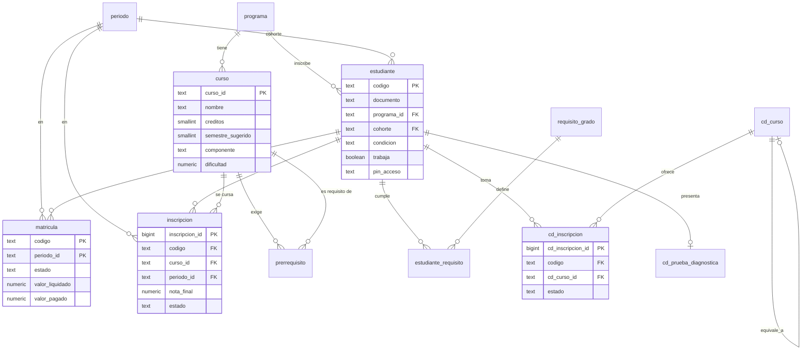
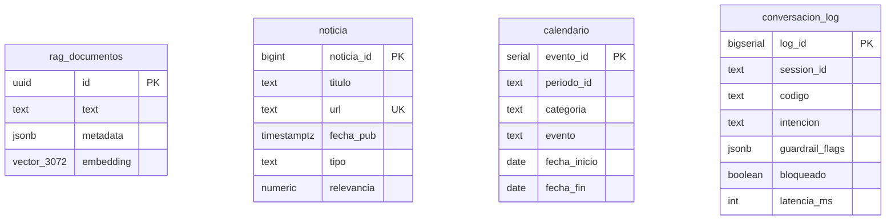

# Base de datos PostgreSQL

Motor: **PostgreSQL 17 con pgvector** en Supabase (East US, Ohio), conexión por Session pooler (IPv4). Scripts en `database/`; se ejecutan en orden desde `database/load_database.py`, que es idempotente (borra y recrea los esquemas `academico` y `chatbot`).

| Archivo | Contenido |
|---|---|
| `01_schema.sql` | Extensiones (`vector`, `pgcrypto`), esquemas, tablas, restricciones e índices |
| `02_views.sql` | Vistas analíticas para los agentes |
| `03_functions_security.sql` | Funciones de búsqueda RAG, `verificar_pin`, rol `mcp_readonly`, `unaccent_lower`, vista `public.rag_documentos` |
| `catalogo.py` | Plan de estudios simulado (50 cursos, 154 créditos), requisitos de grado y oferta del CCD |
| `generate_synthetic_data.py` | Simulación por agentes que genera los CSV en `data/synthetic/` |
| `load_database.py` | Ejecuta los SQL, carga los CSV con `COPY`, carga el calendario y asigna la contraseña del rol |

Datos cargados: 420 estudiantes sintéticos, 9 218 inscripciones a cursos, 1 708 matrículas, 1 096 inscripciones de competencias digitales y 143 pruebas diagnósticas; nota promedio 3.55 y tasa de reprobación 19.7 %.

## 1. Esquemas

- `academico`: simula Banner/COSMOS (estudiantes, matrícula, historial, plan de estudios, competencias digitales).
- `chatbot`: RAG, noticias, calendario y bitácora de conversaciones.
- `public`: solo la tabla de memoria `n8n_chat_histories`, la función `unaccent_lower` y la vista `rag_documentos`.

## 2. Diagrama entidad-relación



Tablas del esquema `chatbot` (sin relaciones foráneas con `academico`):



## 3. Descripción de las tablas

### Esquema `academico`

| Tabla | Descripción |
|---|---|
| `programa` | Programa académico (`ISIS`): SNIES 1643, 9 semestres (8 + práctica), créditos totales (154), tope de créditos por semestre (20). |
| `periodo` | Periodos 2021-1 a 2026-2; índice único parcial que garantiza un solo `es_actual` (2026-2). |
| `curso` | 50 cursos del plan simulado con créditos, semestre sugerido, componente (`Básico`, `Específico`, `Flexible`, `Socio-humanístico`, `Instrumental`, `Práctica`), área y `dificultad` (0–1, usada solo por el simulador; la herramienta `info_curso` no la expone). |
| `prerrequisito` | Aristas del grafo de prerrequisitos: tipo `prerrequisito`, `correquisito` o `creditos` (mínimo de créditos aprobados). Una restricción `CHECK` impide combinaciones inválidas. |
| `requisito_grado` | Requisitos distintos a cursos: `CD_RUTAS`, `INGLES_B1`, `SABER_PRO`, `PAZ_SALVO`. |
| `estudiante` | Datos personales y socioeconómicos simulados; `condicion` (Activo, Graduado, Desertor, etc.); `pin_acceso` con el hash del PIN. |
| `matricula` | Estado financiero/académico por periodo (Matriculado, Pre-matriculado, Pendiente de pago, Reserva de cupo, No matriculado), valor liquidado y pagado. |
| `inscripcion` | Historial de cursos, una fila por intento, con nota (escala 0.0–5.0, aprueba con 3.0) y estado (Aprobado, Reprobado, Cursando, Cancelado, Homologado). |
| `estudiante_requisito` | Cumplimiento de requisitos de grado por estudiante. |
| `cd_curso` | Oferta del Centro de Competencias Digitales: 7 cursos vigentes (3 rutas) y 4 de la oferta anterior a 2026 con `equivale_a` para homologación. |
| `cd_inscripcion` | Cursos de competencias digitales tomados (Aprobado, Reprobado, Inscrito, Cursando, Validado por prueba) por ciclo mensual o vacacional. |
| `cd_prueba_diagnostica` | Puntaje de la prueba diagnóstica; `valida_curso` es una columna generada (`puntaje >= 70`). |

### Esquema `chatbot`

| Tabla | Descripción |
|---|---|
| `calendario` | Copia espejo del calendario de Google Sheets; respaldo de la herramienta `calendario_academico` y del workflow 03. |
| `noticia` | Noticias del scraper (id del CMS como clave, URL única, `tipo`, `relevancia`). Índice por fecha. |
| `rag_documentos` | Base vectorial: `text`, `metadata` JSONB y `embedding vector(3072)`. Índice HNSW sobre `halfvec`, GIN sobre `metadata` y GIN de texto completo en español. Estructura compatible con el nodo *Postgres PGVector Store* de n8n. |
| `conversacion_log` | Bitácora: pregunta, respuesta, intención, `guardrail_flags`, `bloqueado`, latencia y calificación opcional (1–5). |
| `alerta_temprana` | Alertas tempranas del workflow 08 (`database/04_alertas_tempranas.sql`): `codigo`, `generada_en`, `fecha`, `nivel`, `motivos` JSONB, `mensaje` y `estado` (`pendiente`, `revisada`, `enviada`). `UNIQUE (codigo, fecha)` evita duplicados diarios; `mcp_readonly` solo tiene SELECT. |

### Esquema `public`

| Objeto | Descripción |
|---|---|
| `n8n_chat_histories` | Memoria del agente (misma estructura que crea el nodo *Postgres Chat Memory*); `session_id` = código del estudiante. |
| `rag_documentos` (vista) | Vista simple sobre `chatbot.rag_documentos`, actualizable, porque el nodo PGVector de n8n espera una tabla sin esquema. |
| `unaccent_lower(text)` | Minúsculas sin tildes; la usa `info_curso`. |

## 4. Vistas analíticas

Cada vista devuelve datos ya calculados para que el LLM no tenga que hacer aritmética.

| Vista | Qué pregunta del agente responde |
|---|---|
| `v_pga_periodo` | "¿Cuál fue mi PGA en cada periodo y en qué estado académico quedé?" Calcula el PGA ponderado por créditos y aplica el art. 24: > 3.20 Normal; 3.00–3.20 Condicional, que pasa a **En prueba académica** si el periodo anterior también fue Condicional o de prueba; < 3.00 En prueba académica. |
| `v_estudiante_resumen` | "¿Cómo voy en la carrera?" Resumen 360°: créditos aprobados/pendientes, porcentaje de avance, semestre por créditos, PGA acumulado, último periodo, estado académico, cursos en curso, estado de la matrícula actual y saldo pendiente. Es la vista más usada. |
| `v_historial_academico` | "¿Qué cursos he visto y con qué nota?" Historial legible con número de intento. |
| `v_avance_plan` | "¿Qué me falta de cada semestre?" Cada curso del plan con su estado para el estudiante (Aprobado, Cursando, Reprobado (pendiente), Pendiente) y veces reprobado. |
| `v_cursos_habilitados` | "¿Qué cursos puedo inscribir?" Cursos pendientes con prerrequisitos aprobados y créditos mínimos cumplidos; marca repitencias. |
| `v_profundidad_curso` | "¿Qué cursos bloquean a otros?" Consulta recursiva sobre el grafo de prerrequisitos: longitud de la cadena y número de cursos bloqueados. |
| `v_competencias_digitales` | "¿Qué rutas del CCD he cumplido?" Por estudiante y ruta: cumplida, en curso y detalle; reconoce la oferta antigua mediante `equivale_a`. |
| `v_estadistica_curso` | "¿Qué tan difícil es este curso?" Intentos, nota promedio, tasa de reprobación y cursos que bloquea. Alimenta recomendaciones y el Monte Carlo. |
| `v_alertas` | "¿Qué debo atender?" Unión de seis reglas con prioridad y mensaje listo: estado académico de riesgo, matrícula pendiente, cuello de botella (curso reprobado que bloquea 2 o más), ruta de competencias digitales sin cumplir, requisito de grado pendiente (desde 100 créditos) y habilitación de práctica (130 créditos). |
| `v_indicadores_programa` | "¿Cómo está el programa?" Estudiantes activos, PGA promedio, en prueba, condicionales y tasa de deserción. |

## 5. Funciones y seguridad

| Función | Uso |
|---|---|
| `chatbot.match_documentos(query_embedding, match_count, filtro, umbral)` | Búsqueda semántica por coseno con filtro opcional por metadatos (`@>`); castea a `halfvec(3072)` para usar el índice HNSW. |
| `chatbot.buscar_texto(consulta, match_count)` | Búsqueda léxica en español con `tsvector` y `websearch_to_tsquery`. |
| `academico.verificar_pin(codigo, pin)` | `SECURITY DEFINER`: devuelve verdadero si `sha256(CODIGO:PIN)` coincide. Nunca expone el hash. |

### Rol de solo lectura `mcp_readonly`

- `LOGIN` con contraseña asignada por `load_database.py` desde `MCP_DB_PASSWORD`; se conecta con `MCP_DATABASE_URL`.
- `SELECT` sobre todas las tablas de `academico` y `chatbot`.
- Sobre `academico.estudiante` se revoca el `SELECT` general y se concede solo por columnas: `codigo, nombres, apellidos, email, genero, ciudad_origen, colegio_tipo, puntaje_saber11, programa_id, cohorte, condicion, trabaja, beca`. Quedan ocultos `documento`, `pin_acceso` y `fecha_nacimiento`.
- `EXECUTE` solo sobre `match_documentos`, `buscar_texto`, `verificar_pin` y `unaccent_lower`.
- `statement_timeout = 8s` y `search_path = academico, chatbot, public, extensions`.
- No tiene `INSERT`, `UPDATE`, `DELETE` ni DDL.

## 6. Generación de datos sintéticos

`generate_synthetic_data.py` (`--estudiantes 420 --seed 42`) implementa una **simulación basada en agentes**: cada estudiante tiene una habilidad latente y avanza periodo a periodo.

**Población**

- Códigos `U00` + 6 dígitos (más 5 cuentas demo fijas `U00100001`–`U00100005`); nombres con Faker `es_CO`.
- Cohortes entre 2021-1 y 2026-2, con peso creciente hacia las recientes (`0.6 + 0.08·i`).
- Puntaje Saber 11 ~ N(305, 38) recortado a [200, 480]; habilidad = `0.6·(saber − 305)/38 + N(0, 0.8)`.
- 22 % trabaja; 18 % tiene beca; género, ciudad y tipo de colegio con probabilidades fijas.

**Dinámica por periodo**

1. Inscribe los cursos habilitados (prerrequisitos y créditos mínimos), repitencias primero, hasta su carga máxima: 12–15 créditos si trabaja, 16–20 si no, máximo 14 en prueba académica.
2. Nota de cada curso ~ N(μ, 0.55) con `μ = 3.55 + 0.42·habilidad − 1.35·(dificultad − 0.45) − 0.05·max(0, carga − 18) + 0.18·(intento − 1) − 0.15·[trabaja]`, redondeada a un decimal y acotada a [0, 5]. Aprueba con 3.0 o más; 3 % de cancelaciones.
3. Calcula el PGA del periodo y el estado (art. 24); dos periodos consecutivos en prueba académica sacan al estudiante del programa (condición `Inactivo`).
4. Deserción con probabilidad `0.025 + 0.07·[PGA < 3.0] + 0.03·[trabaja]` (70 % `Desertor`, 30 % `Retirado`); 2.5 % de reservas de cupo esporádicas.
5. Quien termina el plan queda `Graduado` (70 %) o `Egresado` (30 %).
6. En el periodo actual (2026-2) los cursos quedan en `Cursando`; la matrícula es 80 % Matriculado, 11 % Pendiente de pago y 9 % Pre-matriculado.

**Competencias digitales y requisitos**

- Cohortes anteriores a 2025-2 pueden tener cursos de la oferta antigua (Cultura Digital, Excel, PowerPoint, Word) homologables.
- Cohortes recientes presentan la prueba diagnóstica ~ N(66 + 6·habilidad, 13); con 70 o más validan Interacción Digital.
- Desde 2026-1 se simula la toma de cursos de las rutas 1, 2 y 3 según la "disciplina" del estudiante.
- Inglés B1, Saber Pro y paz y salvo se asignan con probabilidades dependientes del avance.

**Cuentas demo** con escenarios didácticos fijos (habilidad y condiciones definidas a mano; PIN `1234`): excelente, en prueba académica, cerca de grado, primer ingreso y pendiente de pago.

El PIN se almacena como `sha256("CODIGO:PIN")`.

## 7. Cómo reproducir

```bash
python database/generate_synthetic_data.py --estudiantes 420 --seed 42
python database/load_database.py        # requiere DATABASE_URL (y MCP_DB_PASSWORD) en .env
```

Al final, el cargador imprime los indicadores del programa y el resumen de las cuentas demo, que sirve como verificación.


## Memoria conversacional limpia (`05_memoria_chat.sql`)

Los agentes de n8n escriben en `public.n8n_chat_histories` también sus pasos intermedios (mensajes `ai` con `tool_calls` y mensajes `tool`). La memoria de ventana toma los últimos N mensajes y, si el corte cae en medio de una llamada a herramienta, Gemini rechaza el historial (`function call turn comes immediately after a user turn`). El *trigger* `trg_memoria_solo_texto` descarta esos pasos al insertarlos, de modo que la memoria contiene solo pares pregunta/respuesta: el historial siempre es válido, ocupa menos tokens y los datos de las herramientas ya quedan resumidos en la respuesta.
