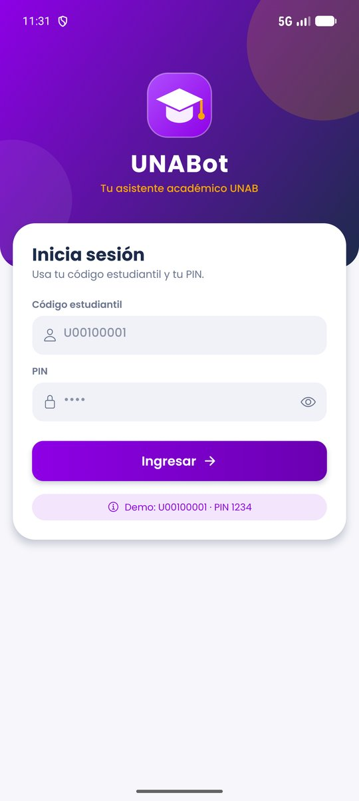
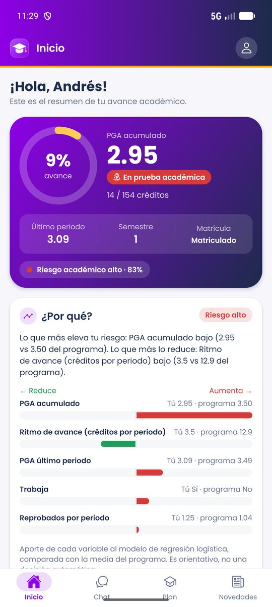
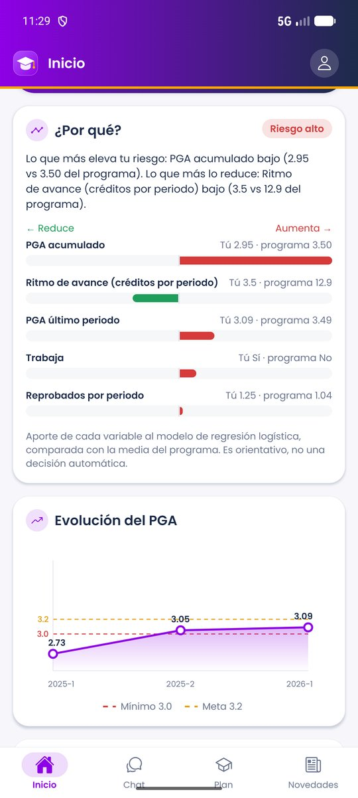
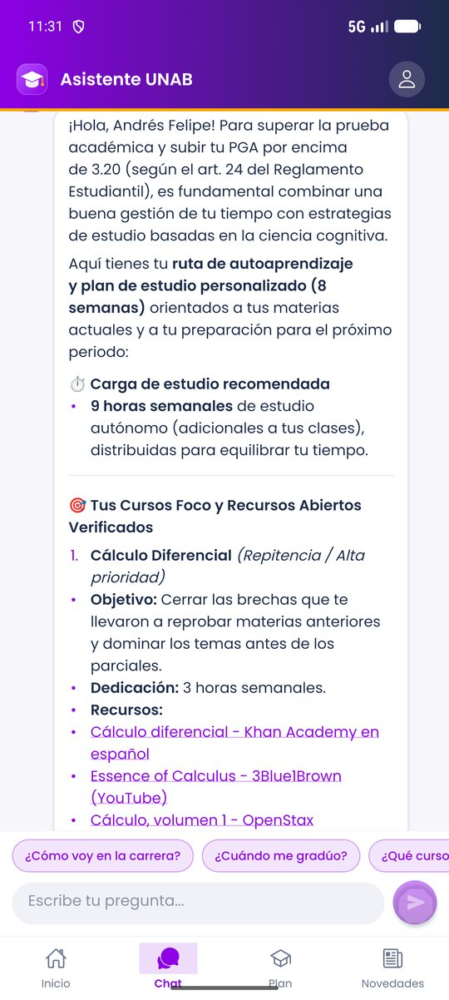
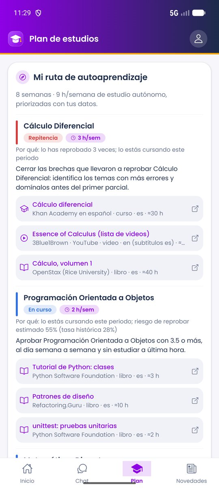
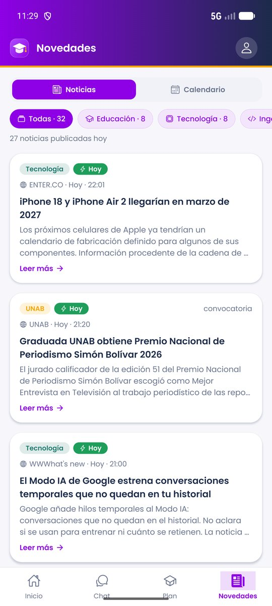
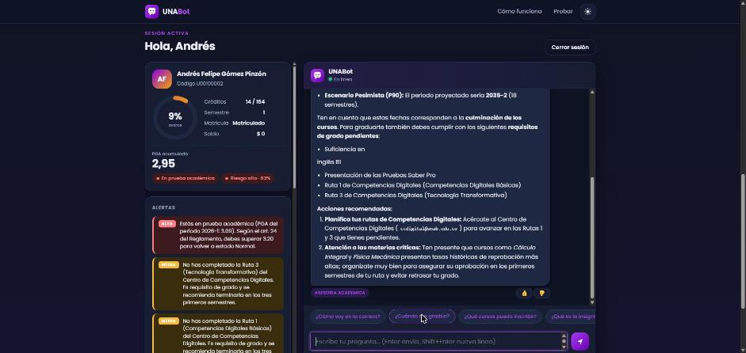
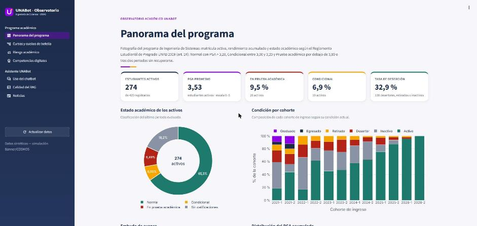

# Manual de usuario de UNABot

Guía para **estudiantes** de Ingeniería de Sistemas de la UNAB y para el equipo de **consejería académica**. Explica cómo instalar la app, iniciar sesión, usar cada pantalla, qué preguntarle al asistente, cómo usar el cliente web y cómo leer el observatorio.

> **Aviso importante.** UNABot es un proyecto académico. El plan de estudios, las fechas del calendario y **todos los datos de los estudiantes son simulados**; no provienen de Banner, COSMOS ni de ningún sistema real de la UNAB. Las normas (Reglamento Estudiantil de Pregrado 2019), las rutas del Centro de Competencias Digitales y las noticias sí son reales. Ver la [nota de honestidad](../README.md#nota-de-honestidad-sobre-los-datos) del README.

## Contenido

1. [Requisitos](#1-requisitos)
2. [Instalación de la app](#2-instalación-de-la-app)
3. [Iniciar sesión](#3-iniciar-sesión)
4. [Recorrido por la app](#4-recorrido-por-la-app)
5. [Qué preguntarle al asistente](#5-qué-preguntarle-al-asistente)
6. [Cliente web](#6-cliente-web)
7. [Observatorio para consejería](#7-observatorio-para-consejería)
8. [Preguntas frecuentes](#8-preguntas-frecuentes)
9. [Solución de problemas](#9-solución-de-problemas)

---

## 1. Requisitos

| Necesitas | Detalle |
|---|---|
| Teléfono Android (APK) o iPhone (Expo Go) | Android reciente; en iPhone, la app gratuita **Expo Go** |
| Conexión a internet | La app consulta el servidor en AWS; sin internet no responde |
| Código estudiantil y PIN | Formato `U` + 8 dígitos (por ejemplo `U00100002`) y PIN de 4 a 8 dígitos |
| Servidor encendido | Está disponible mientras la sesión del **AWS Academy Learner Lab** esté activa (ver [solución de problemas](#9-solución-de-problemas)) |

## 2. Instalación de la app

### 2.1 Android (archivo APK)

1. Desde el teléfono, abre la sección *Releases* del repositorio y descarga **`chatbot-unab.apk`** (unos 45 MB):
   <https://github.com/Daniverd15/chatbot-academico-unab/releases/download/v1.0.0/chatbot-unab.apk>
2. Abre el archivo descargado. Android avisará que **la instalación desde esta fuente está bloqueada**.
3. Toca **Ajustes** y activa **Permitir desde esta fuente** (o *Instalar apps desconocidas*) para el navegador o el gestor de archivos que usaste. El nombre exacto del menú cambia según la marca del teléfono (Ajustes → Seguridad → Fuentes desconocidas).
4. Regresa y toca **Instalar**. Si Play Protect pregunta, elige **Instalar de todos modos**: el APK no está publicado en Google Play y está firmado con una llave de depuración (suficiente para la demostración).
5. Abre **Chatbot UNAB** desde el cajón de aplicaciones.

Por seguridad, vuelve a desactivar el permiso de fuentes desconocidas cuando termines.

### 2.2 iPhone (Expo Go)

No existe un instalador para iOS; se usa **Expo Go**, que ejecuta la app desde un computador:

1. Instala **Expo Go** desde la App Store.
2. En un computador conectado a la misma red Wi-Fi (con Node.js 20+), sigue el [Paso 9 del README](../README.md#paso-9-app-móvil): `cd mobile && npm install` y `npx expo start` con las variables `API_URL` y `APP_API_KEY`. Si no comparten red, agrega `--tunnel`.
3. Escanea el código QR con la **cámara** del iPhone y ábrelo en Expo Go.

Detalles técnicos en [app_movil.md](app_movil.md).

## 3. Iniciar sesión

1. Escribe tu **código estudiantil** (`U########`) y tu **PIN**.
2. Toca **Ingresar**. La app guarda la sesión de forma cifrada en el teléfono (`expo-secure-store`), así que la próxima vez entra sola.
3. Si el código o el PIN son incorrectos verás *«Código o PIN incorrectos»*.

### Cuentas de demostración (PIN `1234`)

| Código | Escenario | Para probar |
|---|---|---|
| `U00100001` | Estudiante excelente: PGA 4.14, 56.5 % de avance | Riesgo bajo, memoria del chat |
| `U00100002` | En prueba académica: PGA 2.95 | Alertas, riesgo alto o medio, recomendaciones de carga reducida |
| `U00100003` | Cerca de grado: 92.2 % de avance; le faltan la Ruta 3 de Competencias Digitales y el inglés B1 | Proyección de grado, requisitos pendientes |
| `U00100004` | Primer ingreso: validó Interacción Digital con la prueba diagnóstica (82) | Competencias digitales y homologación |
| `U00100005` | Matrícula pendiente de pago | Alerta de matrícula y saldo |

## 4. Recorrido por la app

La barra inferior tiene cuatro pestañas: **Inicio**, **Chat**, **Plan** y **Novedades**. El **Perfil** se abre desde el encabezado.

### 4.1 Inicio

| Elemento | Qué muestra |
|---|---|
| **Anillo de avance** | Porcentaje de créditos aprobados sobre el total del plan (154 créditos), con animación |
| **PGA** | Promedio general acumulado y el del último periodo, con su gráfico de evolución |
| **Estado académico** | *Normal* (PGA > 3.20), *Condicional* (3.00 a 3.20) o *En prueba académica*, según el art. 24 del Reglamento Estudiantil de Pregrado 2019, y el estado de matrícula |
| **Riesgo** | Probabilidad estimada de quedar en prueba académica en el siguiente periodo (nivel bajo, medio o alto) |
| **Alertas** | Avisos por prioridad (ALTA, MEDIA, BAJA, INFO), por ejemplo matrícula pendiente |
| **Competencias digitales** | Estado de las 3 rutas del Centro de Competencias Digitales y de la insignia |
| **Proyección de grado** | Semestres restantes y periodo de grado probable (P50) y pesimista (P90), con los cursos de mayor riesgo de reprobar |

**Tarjeta «¿Por qué?» (riesgo explicable).** Debajo del riesgo, la app muestra qué factores empujan la probabilidad hacia arriba o hacia abajo:

- Barras **rojas**: el factor **aumenta** el riesgo. Barras **verdes**: lo **reduce**. Cuanto más ancha, mayor es su contribución.
- Cada fila compara **tu valor** con la **media del programa** (por ejemplo, tu PGA acumulado frente al promedio).
- Los factores son: PGA acumulado, PGA del último periodo, cursos reprobados por periodo, carga de créditos y si trabajas.
- Es una **estimación para acompañarte**, no una sanción ni una predicción segura. Se calcula con un modelo entrenado con datos simulados.

Desliza hacia abajo para **recargar** el tablero.

### 4.2 Chat

- **Sugerencias**: al abrir un chat vacío verás botones con preguntas frecuentes; tócalos para enviarlas.
- **Respuestas** en formato enriquecido (listas, negritas). Si la respuesta cita documentos, aparecen **chips con las fuentes**, que abren el enlace.
- **Mensaje bloqueado**: si tu mensaje activa los guardrails (intento de saltarse las reglas, contenido inapropiado o claves secretas), el asistente responde con un aviso amable y se marca como bloqueado.
- **Leer en voz alta**: toca el icono de altavoz de una respuesta para que la app la lea; tócalo de nuevo para detenerla.
- **👍 / 👎**: califica cada respuesta. Tu voto se guarda para mejorar el sistema y solo tú puedes registrarlo en tus conversaciones.
- **Memoria**: el asistente recuerda lo conversado antes, incluso si cierras la app o inicias sesión otro día.
- Las respuestas tardan entre 2 y 11 segundos; verás una animación de escritura. La primera tras un tiempo sin uso puede tardar más.

### 4.3 Plan

**Plan de estudios por semestres.** Cada curso muestra créditos, nota de aprobación y estado: *Aprobado*, *Cursando*, *Reprobado pendiente* o *Pendiente*, con una leyenda de colores.

**Mi ruta de autoaprendizaje.** Es un plan **semanal** personalizado que parte de tu situación académica. Incluye:

- Objetivos de la semana según tus cursos en curso o pendientes.
- **Recursos** recomendados para cada objetivo.
- **Estrategias de estudio** basadas en evidencia (práctica de recuperación, práctica espaciada, autoevaluación), con tiempos sugeridos.

Úsala como punto de partida: ajústala a tu horario y, al final de la semana, revisa qué lograste. El fundamento pedagógico está en [pedagogia_y_prompts.md](pedagogia_y_prompts.md).

### 4.4 Novedades

Dos secciones con un control segmentado:

- **Noticias**: publicaciones reales de unab.edu.co, recogidas por un scraper cada 12 horas. Puedes **filtrarlas por tema**: *Educación*, *Tecnología*, *Ingeniería de sistemas* y *UNAB*. Cada noticia muestra su **fuente** y su **fecha**; tócala para abrir la publicación original.
- **Calendario**: próximos eventos académicos (inscripciones, pruebas diagnósticas, cursos, plazos). Las fechas provienen de una hoja de Google Sheets del proyecto y son simuladas.

### 4.5 Perfil

Se abre desde el encabezado. Muestra tus datos y permite:

- **Tema**: *Sistema* (sigue el del teléfono), *Claro* u *Oscuro*.
- **Cerrar sesión**: pide confirmación y **borra** la sesión guardada, los datos y los mensajes de la app. Hazlo si prestas el teléfono.

## 5. Qué preguntarle al asistente

El asistente clasifica cada mensaje en uno de **cinco alcances** y lo envía al especialista adecuado. No necesitas elegir: escribe con naturalidad.

| Alcance | Úsalo para | Ejemplos |
|---|---|---|
| **Asesoría académica** (tus datos) | Matrícula, avance, PGA, notas, estado académico, cursos que puedes inscribir, cuándo te gradúas, alertas, requisitos, recomendaciones, prerrequisitos | «¿Cómo voy en la carrera?» · «¿Cuándo me gradúo si inscribo 14 créditos por semestre?» · «¿Qué cursos debo tomar el próximo semestre?» · «¿Qué requisitos me faltan para graduarme?» |
| **Reglamento y CCD** | Normas, procesos, insignia, rutas de competencias digitales, pruebas diagnósticas. Responde con fuentes citadas | «¿Qué es la insignia de competencias digitales?» · «¿Qué pasa si quedo en prueba académica?» |
| **Calendario** | Fechas y plazos | «¿Cuándo son las inscripciones de los cursos vacacionales?» · «¿Cuándo empiezan las clases del 2027-1?» |
| **Cursos realizados** | Tu historial en el Centro de Competencias Digitales | «¿Qué cursos de competencias digitales he tomado?» · «¿Ya puedo obtener la insignia?» |
| **Noticias** | Novedades, convocatorias, becas, cursos | «¿Hay noticias o convocatorias nuevas?» |

Consejos:

- Sé específico y menciona cifras si las tienes («con 14 créditos», «si repruebo Cálculo»).
- Puedes encadenar preguntas: el asistente recuerda el contexto.
- Si algo no está en sus fuentes, te lo dirá y te indicará a quién acudir (Centro de Competencias Digitales: ccdigital@unab.edu.co, Registro Académico o la dirección del programa). **No inventa** fechas ni normas.
- El asistente solo consulta **tus** datos. Si pides los de otro estudiante, será bloqueado y los códigos ajenos se enmascaran en cualquier respuesta.

## 6. Cliente web

Alternativa sin instalación, con el mismo backend y las mismas cuentas: <https://unabot.35-168-41-252.sslip.io>

1. Ingresa tu código y PIN.
2. Usa el chat igual que en la app; las fuentes aparecen como chips y puedes calificar con 👍/👎.
3. La presentación del proyecto está en `/presentacion/` (tecla `f` para pantalla completa).

## 7. Observatorio para consejería

Tablero analítico para el equipo de consejería y la dirección del programa: <https://observatorio.35-168-41-252.sslip.io>. Es de **solo lectura**, los nombres se muestran enmascarados y no expone preguntas en texto libre.

| Página | Para qué sirve |
|---|---|
| **Panorama del programa** | KPIs (activos, PGA promedio, % en prueba y condicional, deserción), estado académico, embudo de avance y distribución del PGA con los umbrales 3.00 y 3.20 |
| **Cursos y cuellos de botella** | Reprobación por curso y periodo, cursos que bloquean a más estudiantes y grafo de prerrequisitos |
| **Riesgo académico** | Distribución del riesgo por cohorte, trabajo y beca; estudiantes de mayor riesgo; **importancia global de cada factor** y un ***waterfall* por estudiante** que explica su predicción (riesgo explicable) |
| **Competencias digitales** | Cumplimiento por ruta, prueba diagnóstica, cursos más tomados e insignia por cohorte |
| **Uso del chatbot** | Conversaciones por día, intenciones, latencia, guardrails y calificaciones 👍/👎 |
| **Calidad del RAG** | Métricas de recuperación y generación (hit@k, MRR, fidelidad) y estadísticas del corpus |
| **Alertas tempranas** | Mensajes de acompañamiento que el workflow diario redactó para estudiantes en prueba académica, condicionales o con alertas altas |
| **Noticias** | Noticias del scraper por tipo, mes y relevancia |

### Cómo usar las alertas tempranas

1. Cada día a las 6:00 el sistema detecta hasta 25 estudiantes que requieren atención y Gemini redacta un mensaje breve (máximo 120 palabras) con 1 o 2 acciones concretas.
2. Los mensajes quedan en estado **pendiente**: **el sistema no contacta al estudiante**.
3. Consejería **revisa** cada mensaje en la página *Alertas tempranas*, lo ajusta si hace falta y decide si lo envía y por qué canal.
4. Úsalo para acompañar, no para sancionar: el modelo de riesgo y los mensajes son orientativos y se basan en datos simulados.

## 8. Preguntas frecuentes

**¿Mis datos son reales?** No. Todo el contenido de estudiantes es sintético; las normas y las noticias sí son públicas y reales.

**¿Qué hace el asistente con mis preguntas?** Las registra en una bitácora para medir calidad y seguridad. El observatorio nunca muestra el texto de las preguntas.

**¿Puede equivocarse?** Sí. Las cifras de avance, PGA y proyección las calculan consultas SQL y algoritmos, no el modelo de lenguaje; pero el texto puede resumir mal. Verifica decisiones importantes con Registro Académico o la dirección del programa.

**¿Por qué mi riesgo es alto?** Abre la tarjeta «¿Por qué?» en Inicio: muestra los factores que más pesan y cómo te comparas con el programa. Habla con consejería para planear una carga de créditos adecuada.

**¿Puedo cambiar mi PIN?** No desde la app. Las cuentas de demostración usan el PIN `1234`.

**¿Funciona en iPhone?** Solo mediante Expo Go o el cliente web; el APK es solo para Android.

**¿Cómo borro mis datos del teléfono?** Cierra sesión desde el Perfil o desinstala la app.

## 9. Solución de problemas

| Síntoma | Causa probable | Qué hacer |
|---|---|---|
| La app o la web se quedan «pensando» o dicen *Servicio no disponible* | El servidor está apagado: el Learner Lab detiene la instancia al terminar la sesión | Pide a quien administra el proyecto iniciar el laboratorio (*Start Lab*) y espera unos 2 minutos; la dirección no cambia |
| La primera respuesta tarda 30 a 60 s | Arranque en frío de n8n y del modelo | Espera y vuelve a intentar; las siguientes son más rápidas (2 a 11 s) |
| *Tiempo agotado* tras 30 s | Cuota gratuita del modelo agotada o servidor lento | Espera un minuto y reintenta; prueba otra pregunta |
| *Sin conexión* | El teléfono no tiene internet | Revisa Wi-Fi o datos. Si ya habías entrado, la app abre con la sesión guardada y recarga cuando haya red |
| *Código o PIN incorrectos* | Datos mal escritos | Revisa el formato `U########` y el PIN (demo: `1234`) |
| Error 401 o 403 | La app no está autorizada (clave incorrecta) | Reinstala la versión oficial del APK |
| No puedo instalar el APK | Fuentes desconocidas bloqueadas | Repite el [paso 3 de la instalación](#21-android-archivo-apk) |
| La app se cierra al abrir en el emulador | APK sin la arquitectura del emulador | Usa el APK de la release (incluye arm64 y x86_64) |
| El chat respondió «Mensaje bloqueado» | Un guardrail se activó | Reformula la pregunta sobre tu situación académica, fechas, competencias digitales o normas |
| Las noticias no se actualizan | El scraper corre cada 12 h | Espera al siguiente ciclo |
| El observatorio tarda en abrir | Carga en frío de Streamlit | Espera unos segundos y recarga |

Para problemas de despliegue o replicación, consulta [despliegue_aws.md](despliegue_aws.md) y los [problemas frecuentes del README](../README.md#problemas-frecuentes-y-solución).
