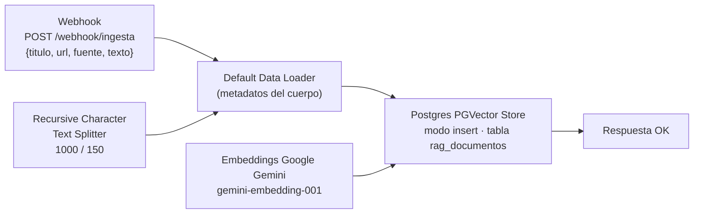

# Implementación del RAG

El RAG responde preguntas sobre documentos institucionales (reglamento, Centro de Competencias Digitales, programa de Ingeniería de Sistemas, noticias) citando la fuente. Hay dos caminos que comparten la misma tabla vectorial `chatbot.rag_documentos`:

- **Ingesta:** `rag/ingest.py` (Python) o el workflow n8n `00 - Ingesta RAG`.
- **Recuperación:** `mcp_server/rag.py` (híbrida, usada por la herramienta MCP `buscar_documentos_institucionales`) y el nodo *Postgres PGVector Store* como herramienta del agente del workflow `02 - Consulta general`.

## 1. Corpus

`rag/fetch_corpus.py` construye `rag/corpus/md/*.md`. Cada archivo lleva un front-matter JSON con `titulo`, `url`, `fuente` y `fecha`, seguido del texto limpio.

| Fuente | Cómo se obtiene | Valor de `fuente` |
|---|---|---|
| Publicaciones del Centro de Competencias Digitales y del programa (cómo funciona la formación, cambios de los cursos de informática desde 2026, pruebas diagnósticas, cursos vacacionales, insignia digital, Ingeniería de Sistemas presencial y virtual) | API REST de WordPress de unab.edu.co: slugs fijos y búsquedas por palabras clave con filtro de relevancia y exclusión de ofertas laborales | `Centro de Competencias Digitales UNAB`, `UNAB` o `Noticias UNAB` |
| Reglamento Estudiantil de Pregrado UNAB 2019 | PDF en `rag/corpus/pdf/`, texto extraído con `pypdf`, cada artículo en su propio párrafo y cada capítulo como sección | `Reglamento Estudiantil` |
| Plan de estudios de Ingeniería de Sistemas | Generado desde `database/catalogo.py` (cursos, créditos, prerrequisitos, requisitos de grado, rutas CCD) | `Programa de Ingeniería de Sistemas` |
| Noticias relevantes | Scraper (`--embed`), ver sección 6 | `Noticias UNAB`, `origen = noticia` |

El corpus actual son **16 documentos Markdown**, que producen **245 fragmentos**, más las noticias relevantes vectorizadas por el scraper.

> El documento del plan de estudios lleva una nota explícita de que es una simulación académica, de modo que el chatbot no lo presente como el pensum oficial.

## 2. Fragmentación (chunking)

Implementada en `trocear()` de `rag/ingest.py`; el workflow n8n usa los mismos parámetros con *Recursive Character Text Splitter*.

- Tamaño objetivo: **1000 caracteres**; solape: **150 caracteres**.
- Primero se divide por secciones (encabezados `## `) y luego por párrafos, acumulando párrafos hasta el tamaño objetivo. Los reglamentos conservan así un artículo completo por párrafo.
- Un párrafo de más de 1500 caracteres se corta por la última oración dentro de los primeros 1000.
- Los fragmentos de menos de 80 caracteres se descartan.
- Cada fragmento se antepone con `"<título del documento> — <sección>"` para que lleve contexto aunque se recupere aislado.
- Metadatos guardados por fragmento: el front-matter más `seccion`, `chunk` y `archivo`.

## 3. Embeddings

- Modelo: `gemini-embedding-001`, **3072 dimensiones** (variable `GEMINI_EMBED_MODEL`).
- Se usan tipos de tarea distintos, como recomienda el modelo: `RETRIEVAL_DOCUMENT` al ingerir y `RETRIEVAL_QUERY` al consultar.
- La ingesta procesa lotes de 40 fragmentos con reintentos exponenciales (5 s, 10 s, 20 s…, hasta 6 intentos) para tolerar la cuota de la capa gratuita.
- `rag/ingest.py` reemplaza todo el contenido que no sea noticia (`DELETE ... WHERE metadata->>'origen' IS DISTINCT FROM 'noticia'`), por lo que es seguro volver a ejecutarlo sin perder las noticias.
- `python rag/ingest.py --dry-run` muestra solo estadísticas de fragmentación.

## 4. Índice: HNSW sobre `halfvec`

La columna es `embedding vector(3072)`. pgvector **limita a 2000 dimensiones los índices (HNSW e IVFFlat) sobre el tipo `vector`**, por lo que no se puede indexar directamente un embedding de 3072. La solución, disponible desde pgvector 0.7, es un **índice de expresión sobre `halfvec`** (precisión de 16 bits, hasta 4000 dimensiones indexables):

```sql
CREATE INDEX ix_rag_embedding ON chatbot.rag_documentos
    USING hnsw ((embedding::halfvec(3072)) halfvec_cosine_ops);
```

Justificación:

- Se conserva la columna original en precisión completa (`vector`) y se indexa la copia reducida; la pérdida de precisión del `halfvec` es despreciable para ranking.
- Se evita reducir dimensiones (la API permite acortar el embedding, pero se perdería calidad y compatibilidad con el nodo de n8n).
- HNSW no requiere entrenamiento previo y funciona bien con pocos miles de filas.

Para que el planificador use el índice, **la consulta debe usar la misma expresión**. Por eso `chatbot.match_documentos` castea ambos lados a `halfvec(3072)`:

```sql
1 - ((d.embedding::halfvec(3072)) <=> (query_embedding::halfvec(3072))) AS similitud
... ORDER BY (d.embedding::halfvec(3072)) <=> (query_embedding::halfvec(3072))
```

Índices adicionales: GIN sobre `metadata` (filtros `@>`) y GIN sobre `to_tsvector('spanish', text)` para la búsqueda léxica.

## 5. Recuperación híbrida con RRF

`mcp_server/rag.py` combina dos rankings:

1. **Semántico:** embedding de la pregunta (`RETRIEVAL_QUERY`) y `match_documentos(…, k·2)` por coseno.
2. **Léxico:** `buscar_texto(pregunta, k·2)` con `websearch_to_tsquery('spanish', …)`, útil para siglas, nombres propios y números (por ejemplo "Ruta 3", "SNIES", "art. 24") que los embeddings capturan peor.

Los dos rankings se fusionan con **Reciprocal Rank Fusion (RRF)**:

$$
\text{score}(d) = \sum_{r \in \{\text{semántico},\ \text{léxico}\}} \frac{1}{60 + \text{pos}_r(d)}
$$

donde `pos` es la posición del documento en cada lista (1 es el mejor) y 60 es la constante estándar. En el código, `scores[id] += 1.0 / (60 + pos + 1)` con `pos` desde 0. Un fragmento que aparece en ambas listas suma ambos aportes y sube; RRF no necesita normalizar escalas de puntajes distintas (similitud coseno frente a `ts_rank`).

Detalles de la implementación:

- Se devuelven los `k` mejores (la herramienta limita `k` entre 1 y 8; por defecto 5) con `fragmento`, `titulo`, `fuente` (URL), `similitud` y `score_rrf`.
- Si el embedding falla (cuota o red), se imprime el aviso y se **continúa solo con la búsqueda léxica**.
- El embedding de la consulta se cachea en memoria (`lru_cache`, 256 entradas).
- La función acepta un filtro por `fuente` mediante metadatos.
- La respuesta incluye la instrucción "Responde SOLO con base en estos fragmentos y cita la fuente", que el agente debe seguir.

## 6. Noticias y el scraper

`scraper/scraper_noticias.py` consulta la API de WordPress de unab.edu.co por categorías (Ingeniería de Sistemas, Facultad de Ingeniería, Estudiantes, Éxito estudiantil, Cursos, Educación continua) y por búsquedas (competencias digitales, convocatoria, certificación, inteligencia artificial, beca, práctica, hackathon, semillero). Si la API falla, usa un respaldo que parsea el HTML de la categoría Estudiantes.

- Clasifica cada noticia (`certificación`, `curso`, `convocatoria`, `evento`, `general`) con reglas de expresiones regulares.
- Asigna un **puntaje de relevancia** por palabras clave (sistemas, IA, competencias digitales, becas, etc.), con el título contando doble y un decaimiento exponencial con vida media de 90 días.
- Hace `UPSERT` en `chatbot.noticia` (conflicto por `noticia_id`); con `--embed` vectoriza solo las noticias **nuevas con relevancia ≥ 1.0** y las inserta en `rag_documentos` con `origen = noticia`.
- Se obtuvieron **83 noticias reales** de unab.edu.co en la primera carga.
- Desde la versión multifuente también trae noticias del día de medios externos (Google News, Semana, El Tiempo, ENTER.CO, Impacto TIC, Xataka, WWWhat's new), clasificadas por tema (`educacion`, `tecnologia`, `ingenieria_sistemas`, `institucional`) y con el nombre del medio en `fuente_nombre`. Ver [scraper.md](scraper.md).
- Se ejecuta con `python scraper/scraper_noticias.py --embed`, con `cron` (`0 */12 * * *`) o desde n8n cada 12 horas (workflow 05b).

## 7. Ingesta con n8n (workflow 00)



El nodo escribe a través de la vista `public.rag_documentos`, que apunta a `chatbot.rag_documentos`. Es la forma de ingerir un documento nuevo sin ejecutar scripts: basta un `POST` al webhook. Ver [workflows_n8n.md](workflows_n8n.md).

## 8. Uso desde los agentes

- **Workflow 02 (Consulta general):** el agente de Gemini tiene el PGVector Store como herramienta (recuperar como herramienta, top 6) y responde con fuentes.
- **Servidor MCP:** `buscar_documentos_institucionales(pregunta, k)`, con recuperación híbrida; disponible para el agente 06 y para clientes como Claude Desktop.

## 9. Limitaciones

- La herramienta del nodo PGVector de n8n solo hace búsqueda vectorial; la fusión híbrida con RRF existe únicamente en `mcp_server/rag.py`.
- `websearch_to_tsquery` exige todos los términos significativos: una pregunta muy larga puede no tener coincidencias léxicas y el resultado depende del componente semántico.
- No hay reranking con un modelo cruzado ni evaluación formal de la recuperación (por ejemplo recall@k con preguntas etiquetadas).
- Los documentos se reemplazan por completo al reingerir; no hay control de versiones ni detección de cambios por documento.
- La cuota gratuita de Gemini limita el ritmo de la ingesta y de las consultas; los reintentos mitigan pero no eliminan el problema.
- El plan de estudios del corpus es simulado, y el reglamento es de 2019: si cambia, hay que volver a descargar el PDF y reingerir.
- Las noticias vectorizadas se añaden solo cuando son nuevas; una noticia actualizada en origen no se reindexa.
