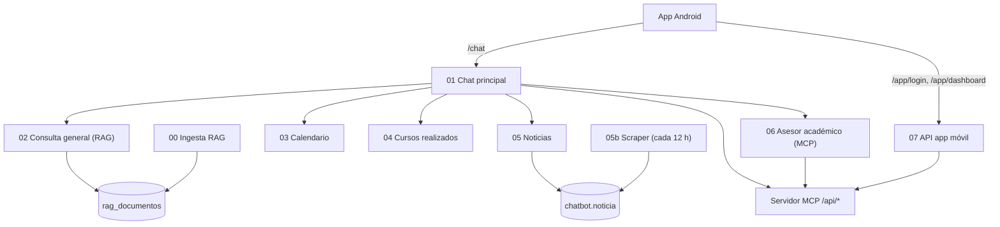
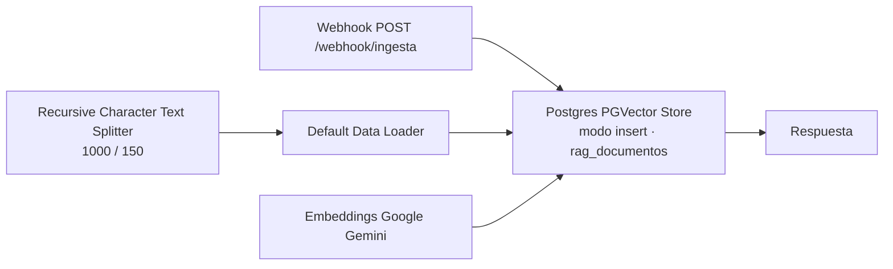
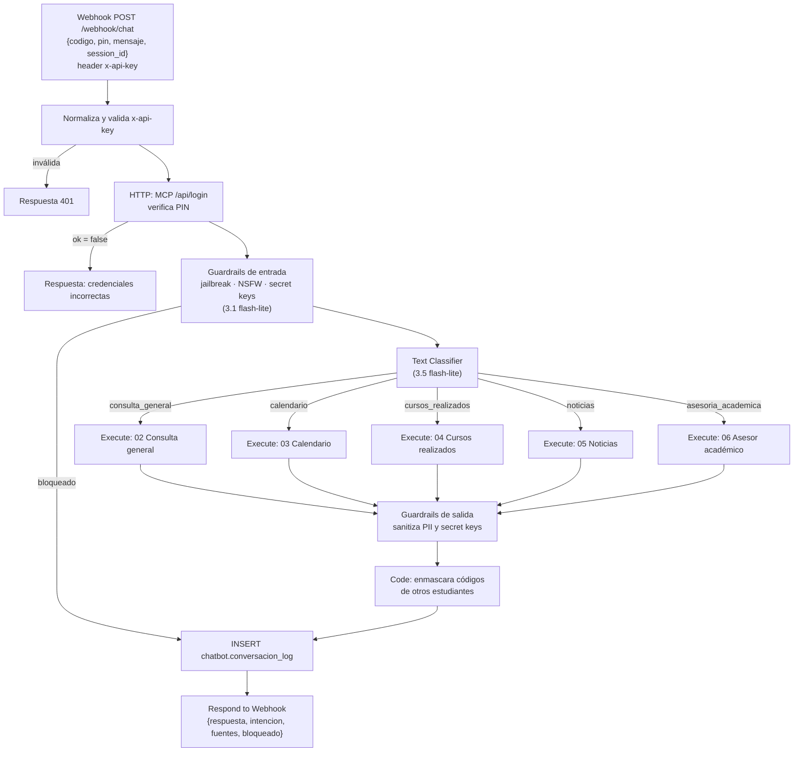
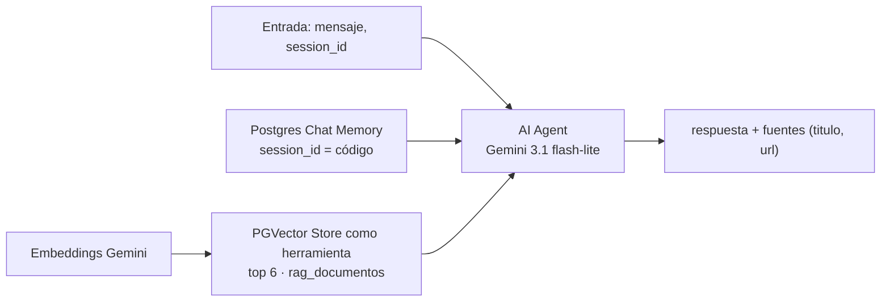
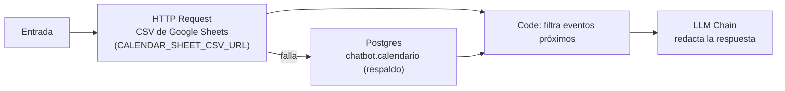
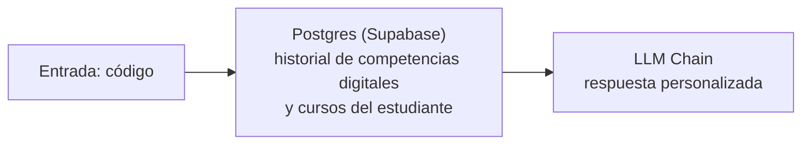
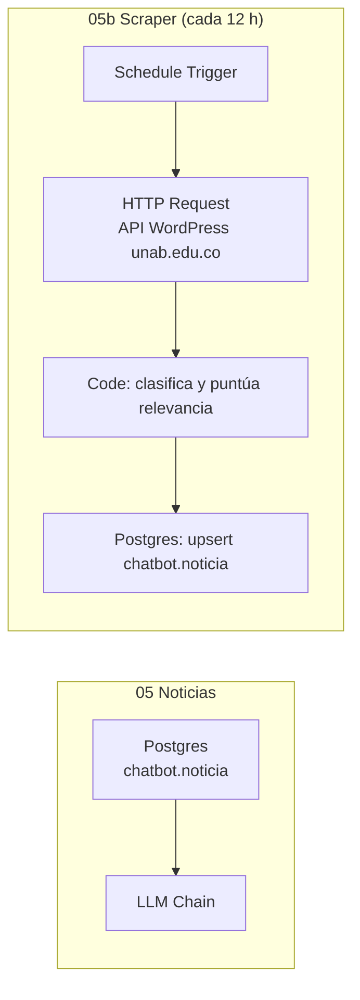
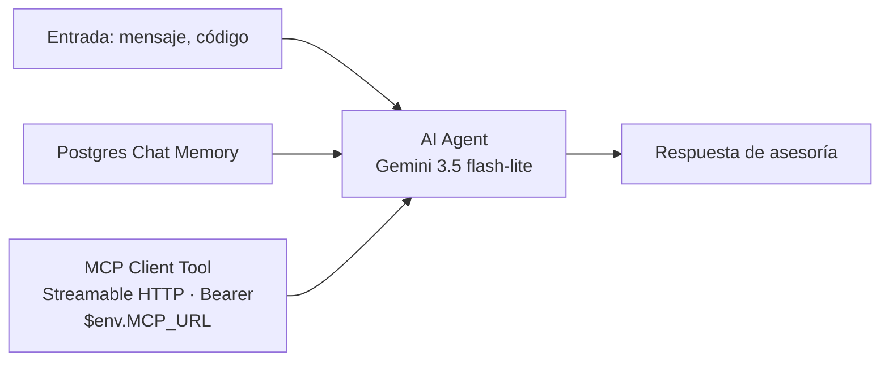
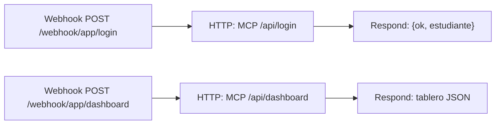

# Workflows de n8n

> **Fuente de verdad.** Los workflows están en `n8n/workflows/*.json`, los genera `n8n/build_workflows.py` y los importa `n8n/setup_n8n.sh`. Si algún nombre de nodo difiere, el JSON es la referencia. Los endpoints del servidor MCP citados aquí (`/api/login`, `/api/dashboard`, `/mcp`) están implementados en `mcp_server/server.py`.

n8n 2.47 corre en Docker (`docker-compose.yml`) detrás de Caddy en `https://n8n.35-168-41-252.sslip.io`. Zona horaria `America/Bogota`. Las variables `MCP_URL`, `MCP_AUTH_TOKEN`, `CALENDAR_SHEET_CSV_URL` y `APP_API_KEY` se inyectan al contenedor y se leen en los workflows con `$env`.

## 1. Mapa de workflows

| N.º | Nombre | Disparador | Función |
|---|---|---|---|
| 00 | Ingesta RAG | Webhook `POST /webhook/ingesta` | Vectoriza un documento nuevo en `rag_documentos` |
| 01 | Chat principal (router) | Webhook `POST /webhook/chat` | Valida, aplica guardrails, clasifica intención y deriva |
| 02 | Consulta general (RAG) | Execute Workflow desde 01 | Agente con búsqueda vectorial y fuentes |
| 03 | Consulta de calendario | Execute Workflow desde 01 | Eventos próximos desde Google Sheets |
| 04 | Cursos realizados | Execute Workflow desde 01 | Historial y competencias digitales del estudiante |
| 05 | Noticias | Execute Workflow desde 01 | Noticias recientes de la UNAB |
| 05b | Scraper programado | Schedule Trigger cada 12 h | Actualiza `chatbot.noticia` |
| 06 | Asesor académico (agente MCP) | Execute Workflow desde 01 | Agente con las herramientas del servidor MCP |
| 07 | API app móvil | Webhooks `/webhook/app/login` y `/webhook/app/dashboard` | Login y tablero de la app |

Archivos: `n8n/workflows/00_ingesta.json`, `01_chat.json`, `02_general.json`, `03_calendario.json`, `04_cursos.json`, `05_noticias.json`, `05b_scraper.json`, `06_asesor.json` y `07_app.json`.



## 2. Credenciales requeridas en n8n

| Credencial | Uso |
|---|---|
| Google Gemini (PaLM) API | Modelos de chat, clasificador, guardrails y embeddings |
| Postgres (Supabase, Session pooler) | Memoria de chat, log, noticias, PGVector Store, consultas SQL. Necesita permisos de escritura en `chatbot.*` y `n8n_chat_histories` |
| Header Auth / Bearer (MCP) | `Authorization: Bearer <MCP_AUTH_TOKEN>` para el MCP Client Tool y los HTTP Request al servidor MCP |

Los valores secretos se cargan en n8n (cifrados con `N8N_ENCRYPTION_KEY`), nunca en el código de los workflows.

## 3. Modelos

| Uso | Modelo |
|---|---|
| Agente asesor MCP (06) | `gemini-3.5-flash-lite` |
| Agente RAG (02) | `gemini-3.1-flash-lite` |
| Clasificador de intención y cadenas de redacción (calendario, cursos, noticias) | `gemini-3.5-flash-lite` |
| Guardrails de entrada y salida | `gemini-3.1-flash-lite` |
| Embeddings | `gemini-embedding-001` (3072 dimensiones) |

**Decisión de modelos.** En la capa gratuita de Gemini, los modelos *flash* completos tardaron unos 20 s por llamada y agotaron la cuota (error 429) tras 2 llamadas, mientras que los *flash-lite* responden en unos 1 s. Por eso todos los agentes usan modelos *lite*, y el trabajo se reparte entre `gemini-3.5-flash-lite` y `gemini-3.1-flash-lite`, que tienen cuotas independientes. Todos los nodos LLM tienen reintentos (3 intentos).

## 4. Memoria persistente

Los agentes (02 y 06) usan el nodo **Postgres Chat Memory** con la tabla `n8n_chat_histories` de Supabase y `session_id` igual al **código del estudiante**. Así la conversación se conserva entre mensajes, sesiones de la app y reinicios del contenedor. La bitácora de auditoría es aparte (`chatbot.conversacion_log`).

---

## 5. Workflow 00 — Ingesta RAG

Permite agregar documentos sin ejecutar scripts. Alternativa en Python: `rag/ingest.py`.



- **Entrada:** `{ "titulo": "...", "url": "...", "fuente": "...", "texto": "..." }`.
- **Salida:** confirmación de inserción.
- Metadatos guardados: `titulo`, `url`, `fuente`, para que las respuestas puedan citar.

Ejemplo:

```bash
curl -X POST https://n8n.35-168-41-252.sslip.io/webhook/ingesta \
  -H "Content-Type: application/json" \
  -d '{"titulo":"Nuevo comunicado","url":"https://unab.edu.co/...","fuente":"UNAB","texto":"..."}'
```

## 6. Workflow 01 — Chat principal (router)

Es el único punto de entrada del chat.



- **Entrada:** JSON `{codigo, pin, mensaje, session_id}` y cabecera `x-api-key` igual a `APP_API_KEY`.
- **Salida:** `{respuesta, intencion, fuentes, bloqueado}`. Si un guardrail bloquea el mensaje, `bloqueado = true` y la respuesta es un aviso amable; la app muestra el escudo "Mensaje bloqueado".
- **Guardrails de entrada** (nodo nativo *Guardrails*): jailbreak, contenido NSFW y claves secretas.
- **Guardrails de salida:** sanitización de PII y secretos, más un nodo *Code* que reemplaza cualquier código `U########` distinto al de la sesión.
- **Intenciones:** `consulta_general`, `calendario`, `cursos_realizados`, `noticias`, `asesoria_academica`.
- **Registro:** se guardan sesión, código, intención, pregunta, respuesta, banderas de guardrail, estado de bloqueo y latencia.

## 7. Workflow 02 — Consulta general (RAG)



El agente decide cuándo recuperar fragmentos, responde solo con base en ellos y devuelve la lista de fuentes que la app muestra como chips. Preguntas típicas: "¿Qué es la insignia de competencias digitales?", "¿Qué dice el reglamento sobre prueba académica?".

## 8. Workflow 03 — Consulta de calendario



Las fechas del calendario son simuladas (`data/calendario_academico.csv`). El workflow lee la URL del CSV publicado de Google Sheets desde `CALENDAR_SHEET_CSV_URL`. **Estado actual:** la hoja aún no está publicada; mientras la variable esté vacía, el workflow usa la tabla de respaldo `chatbot.calendario`. La misma lógica existe como herramienta MCP `calendario_academico`.

## 9. Workflow 04 — Cursos realizados



Consulta las vistas `v_competencias_digitales` y `v_historial_academico` filtradas por el código de la sesión (el código viene del paso de login, no del texto del usuario) y redacta la respuesta.

## 10. Workflow 05 — Noticias y 05b — Scraper programado



El workflow 05b replica en n8n la lógica de `scraper/scraper_noticias.py` (clasificación por tipo y puntaje de relevancia con decaimiento de 90 días). El script de Python puede ejecutarse a mano o por `cron` como alternativa, y es el que además vectoriza noticias con `--embed`.

## 11. Workflow 06 — Asesor académico (agente MCP)



El agente descubre las herramientas del servidor FastMCP: `consultar_estado_matricula`, `avance_plan_estudios`, `historial_academico`, `cursos_habilitados`, `proyeccion_graduacion` (Monte Carlo), `alertas_requisitos`, `competencias_digitales`, `recomendaciones_personalizadas`, `info_curso`, entre otras (detalle en [servidor_mcp.md](servidor_mcp.md)). El prompt del sistema le indica el código del estudiante de la sesión y que no consulte otros códigos.

## 12. Workflow 07 — API de la app móvil



- **Entrada:** `{codigo, pin}` y cabecera `x-api-key`.
- **Salida de login:** `{ok, mensaje?, estudiante: {codigo, nombre_completo, programa, cohorte}}`.
- **Salida de dashboard:** `{ok, resumen, alertas, competencias, avance, proyeccion, riesgo, noticias, calendario}`.

Los dos endpoints del servidor MCP ya consolidan las consultas, de modo que el workflow solo reenvía y responde. El contrato completo está en [app_movil.md](app_movil.md).

## 13. Cómo importar los workflows

Con los contenedores arriba (`docker compose up -d`):

```bash
# 1. Regenerar los JSON (opcional)
python n8n/build_workflows.py

# 2. Crear credenciales, importar y publicar en la instancia de n8n
bash n8n/setup_n8n.sh
```

`setup_n8n.sh` crea las tres credenciales de la sección 2, importa los archivos de `n8n/workflows/` con la CLI de n8n (`n8n import:workflow`), publica primero los sub-workflows y al final el chat, y reinicia n8n. Para revisar los errores de las ejecuciones fallidas: `bash n8n/ver_errores.sh`.

Después, en el editor (`https://n8n.35-168-41-252.sslip.io`):

1. Verificar que los workflows 00, 01, 05b y 07 aparezcan activos y que los sub-workflows referenciados por los nodos *Execute Workflow* del 01 estén importados.
2. Probar:

```bash
curl -X POST https://n8n.35-168-41-252.sslip.io/webhook/chat \
  -H "x-api-key: $APP_API_KEY" -H "Content-Type: application/json" \
  -d '{"codigo":"U00100001","pin":"1234","mensaje":"¿Cómo voy en la carrera?","session_id":"U00100001"}'
```

Se espera `{"respuesta": "...", "intencion": "asesoria_academica", "fuentes": [], "bloqueado": false}`.
